[English](README.md) · [Español](README.es.md) · **Català** · [Galego](README.gl.md) · [Euskara](README.eu.md)

  

# Turnly

Abans es deia Cuadrante.

Calendari de torns per a qui treballa a torns a Espanya: sanitat, policia,
bombers, indústria, hostaleria o qualsevol altre sector. Organitza matins, tardes,
nits, guàrdies i dies lliures, i consulta el proper torn d’un cop d’ull. Cinc
idiomes: español, català, galego, euskara i English.

**Gratis · Sense anuncis · Sense compte · Sense connexió · Codi obert**

Totes les funcions disponibles són obertes, sense Pro ni compres dins de l’app.

## Baixades

  
  
  

Android en proves obertes a Google Play; iPhone, a l’App Store. Mode clar i fosc.

**Feies servir l’app anterior d’Android?** Turnly és ara una app nova (`es.turnly.app`) i no actualitza l’antiga (`es.cuadrante.app`); es poden tenir les dues instal·lades. A l’antiga ves a Configuració › Còpia de seguretat i toca «Desa una còpia fora de Turnly»; a la nova fes servir «Importa un fitxer». Torna a configurar widgets i alarmes i desinstal·la l’antiga.

Instal·la des de Google Play

Turnly és en prova oberta a Google Play, així que qualsevol pot instal·lar-la:

1. Obre [Turnly a Google Play](https://play.google.com/store/apps/details?id=es.turnly.app) des del mòbil o l’ordinador.
2. Instal·la l’app (si ho demana, uneix-te a la prova oberta). S’actualitzarà sola.

Els comentaris, a turnly@mainshai.com.

Instal·la l’APK des de GitHub

També pots baixar l’APK de la [darrera versió](https://github.com/dferrandizmont/turnly/releases) i instal·lar-lo a mà (cal permetre «instal·lar aplicacions d’origen desconegut»). Des de la 0.8.3 està signat amb la mateixa clau que la versió de Google Play, així que dins del mateix paquet (`es.turnly.app`) pots passar de l’una a l’altra sense desinstal·lar i sense perdre res; Android només no deixa tornar a una versió més antiga. Per passar d’`es.cuadrante.app` a `es.turnly.app`, segueix els passos d’exportar i importar de dalt. Les versions publicades abans de la 0.12.1 són de l’app anterior (`es.cuadrante.app`); mira la nota de dalt per passar les teves dades.

## Captures

  <a href="docs/readme/ca/01-mes.png">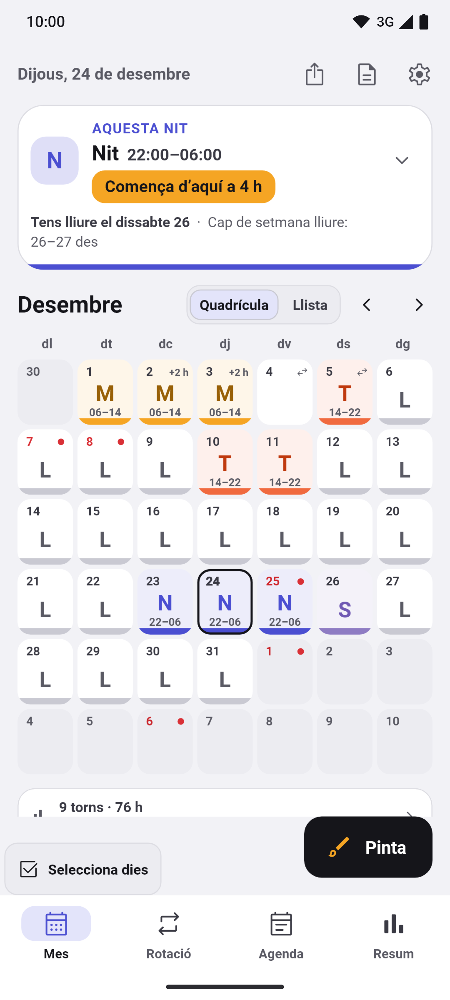</a>
  <a href="docs/readme/ca/02-lista.png">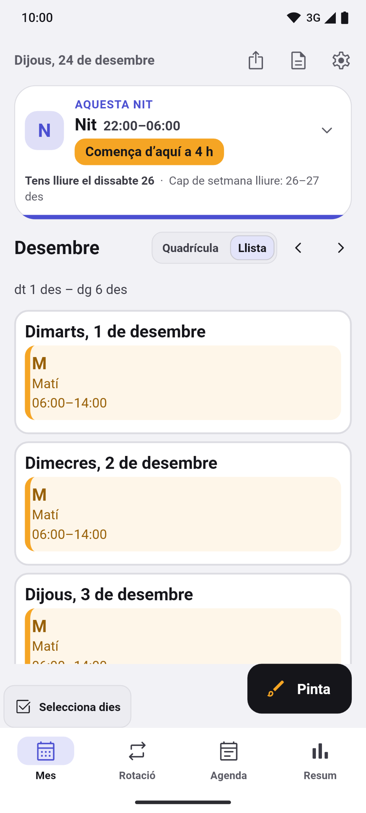</a>
  <a href="docs/readme/ca/03-pintar.png">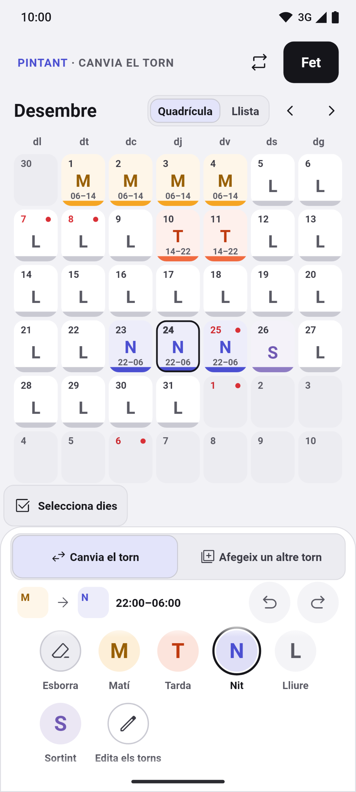</a>
  <a href="docs/readme/ca/04-rotaciones.png">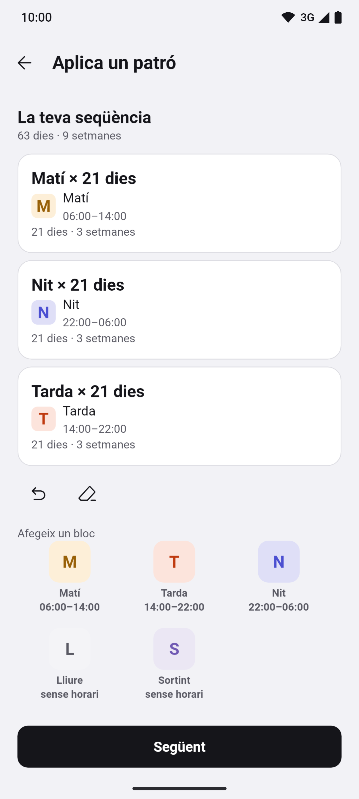</a>
  <a href="docs/readme/ca/05-horas.png">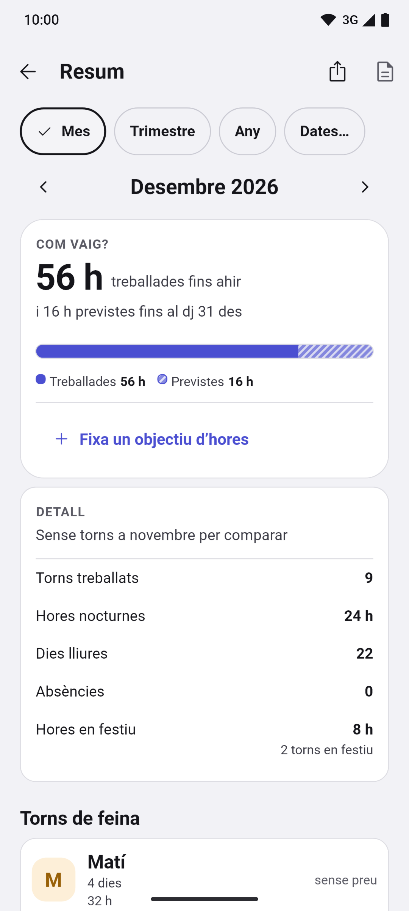</a>

Més captures

  <a href="docs/readme/ca/06-festivos.png">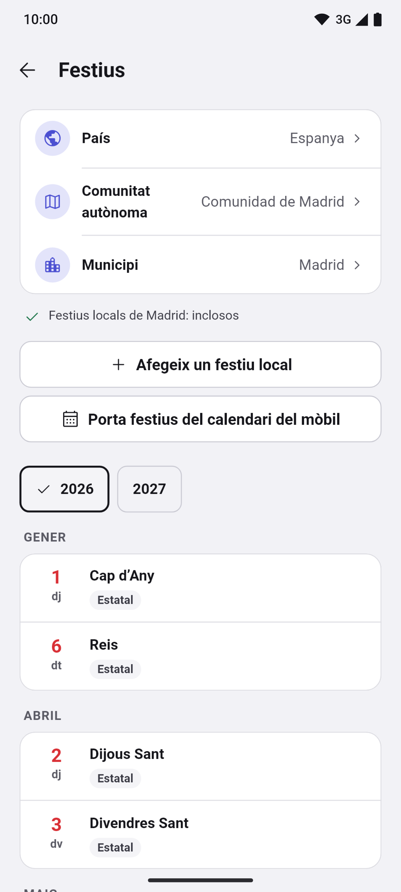</a>
  <a href="docs/readme/ca/07-mes-oscuro.png">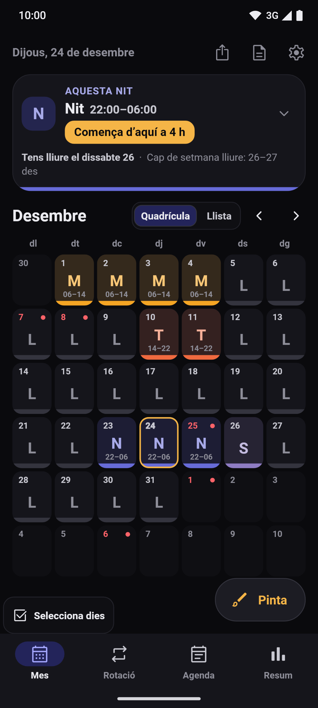</a>
  <a href="docs/readme/ca/08-vacaciones.png">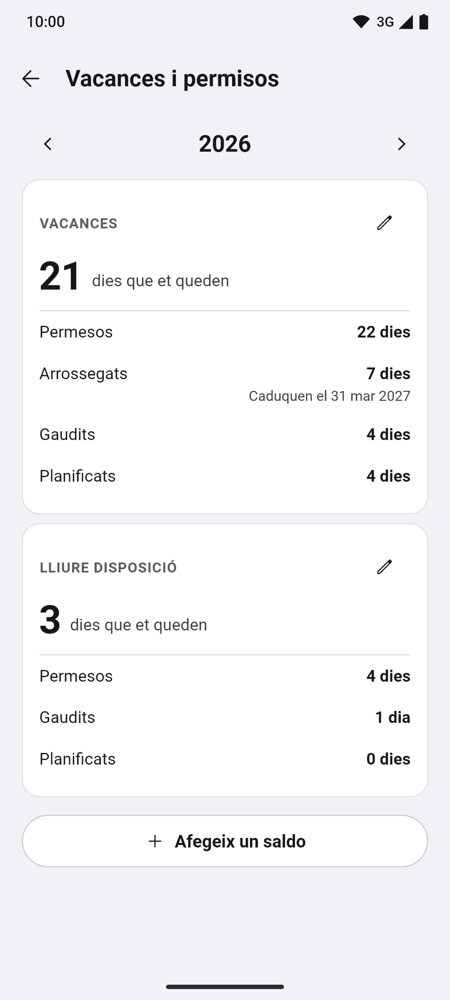</a>
  <a href="docs/readme/ca/09-cambios.png">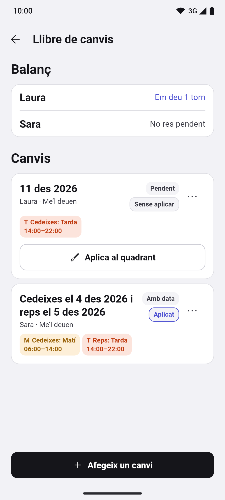</a>
  <a href="docs/readme/ca/10-primer-uso.png">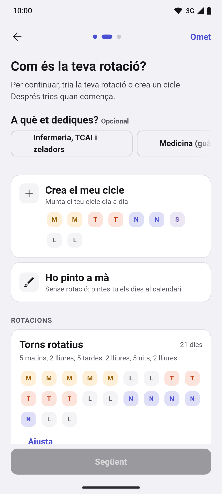</a>
  <a href="docs/readme/ca/11-widgets.png">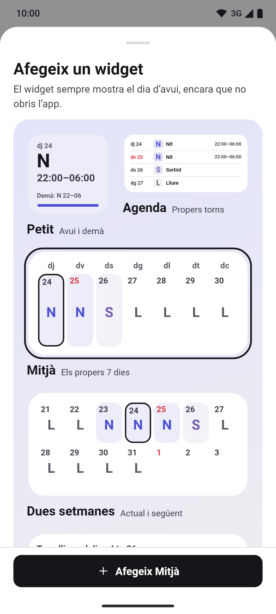</a>

Prem una captura per ampliar-la. Pantalles reals amb dades fictícies, generades
per [tests de Flutter](app/test/store/), també [en castellà](README.es.md#capturas).

## Funcions

- **Mes, rotació, agenda i resum.** Barra inferior (Mes · Rotació · Agenda ·
  Resum) i targeta d’avui plegable amb el proper torn, el proper dia lliure i la
  ratxa. Cada torn porta color, codi i horari, en quadrícula o llista, amb vista
  anual i notes per dia. Sota el mes, una franja amb els torns, les hores respecte
  de l’objectiu i el proper dia lliure; toca-la per obrir el resum d’aquell mes.
- **Pintar torns i rotacions.** Toca o arrossega per seleccionar diversos dies,
  doblar, copiar i enganxar, desfer i refer; assistent de rotacions amb vista
  prèvia: torns rotatius, 24/72, 4×4, 6×4, 5×2, 2-2-3, «2 i 2», «3 i 1» i patrons
  propis. En les dues noves tries el torn de treball. Tipus de torn, colors,
  icones i horaris editables.
- **Festius per país.** Espanya amb les seves comunitats i municipis, i 21 països
  més (Portugal, Brasil, Llatinoamèrica, Europa, Estats Units i Canadà), tot
  sense connexió, a més dels que hi afegeixis tu.
- **Alarmes, widgets i no molestar.** Alarma per tipus de torn, recordatoris de
  notes i widgets d’Android, inclòs un de quatre setmanes. Mostren extres i
  sortides anticipades; el de set dies suma les hores. A Android, «Silencia
  el mòbil durant els meus torns» el silencia mentre treballes. La puntualitat
  depèn dels permisos i les restriccions del sistema. A l’iPhone també hi ha
  widgets, a la pantalla d’inici i a la de bloqueig.
- **Còpia, informes i calendari del mòbil.** Còpies de seguretat locals
  automàtiques i, a Android, una còpia diària a la carpeta que triïs (Drive,
  Dropbox, OneDrive o el mòbil), amb vista prèvia en restaurar i «Prova la
  restauració». Informes en PDF i CSV d’un mes o de les dates que vulguis,
  «Mantenir al dia» per seguir els teus torns al calendari del mòbil, i
  importació des de LRHSoft, `.ics`, CSV i el calendari del mòbil.
- **Hores, diners i permisos.** Hores treballades, nocturnes i festives, sortides
  anticipades i extres per blocs, amb tipus i tarifa; tries si cada tipus compta
  per a l’objectiu d’hores. El Resum i el PDF mostren la ratxa més llarga de dies
  treballats seguits. Plusos de nit i de festiu per hora; estimació bruta i
  neta amb la retenció que posis. Saldos de vacances i permisos per any i tipus,
  amb els dies arrossegats i els que et queden.

Més funcions

- **Rotació des del dia.** Inicia, acaba o reprèn la rotació des del detall d’un
  dia, amb una explicació del que canvia i l’opció de desfer.
- **Llibre de canvis.** Anota un torn que cedeixis o rebis d’un company, mira el
  seu balanç («Em deu 2 torns», «Li dec 1 torn»), l’estat i els torns de cada
  canvi, i aplica’l al calendari amb un sol desfer.
- **Adjunts i tasques.** A «Més opcions» d’un dia, «Adjunts» desa les fotos, els
  dibuixos i els fitxers d’aquell dia, i «Tasques» n’és la llista de comprovació,
  cadascuna amb un desfer.
- **Comparar calendaris i cites del mòbil.** Fins a sis calendaris alhora i les
  cites del mòbil al costat dels teus torns; Turnly només les llegeix.
- **Aparença.** Colors d’accent, paletes preparades, imatge de fons del
  calendari, la primera línia de la nota a la casella del mes, un clic en pintar
  i el codi del torn més gran.
- **Diversos calendaris.** Tots els que vulguis, cadascun amb les seves rotacions
  i els seus dies.
- **Accessibilitat.** Selector d’idioma, lector de pantalla, text ampliable i
  torns que no depenen mai només del color.

## Privacitat

Els torns i la configuració es desen al mòbil. Sense servidor propi, analítica,
seguiment ni enviament d’informes d’errors. L’app demana permís de **calendari** en
importar o exportar, i de **notificacions i alarmes** en activar els avisos.

Permisos i còpies

No demana ubicació, contactes, càmera ni micròfon.

Les còpies del sistema de Google o Apple poden incloure les teves dades, també les
absències. Si exportes a un calendari sincronitzat o comparteixes una còpia, les
dades van a la destinació que triïs. El fitxer de còpia `.turnly` no està xifrat.

[Web](https://turnly.mainshai.com/ca/) · [Política de privacitat](https://turnly.mainshai.com/ca/privacy/) ·
[Detall tècnic](docs/privacy.md) (en castellà) · Suport: **turnly@mainshai.com**.

## Novetats

- **0.13.0 (26-nov-2026):** Android: Els dies d’un canvi aplicat es marquen al mes i indiquen amb qui és al detall. Si en desar un canvi falta una dada, el formulari et porta directament al camp i els avisos ja no tapen «Aplica al quadrant». La tira de resum del mes sempre queda sota els dies. Amb lletra gran i en horitzontal, el Resum, el primer cop, el panell del dia i la Plantilla de plusos es llegeixen millor. Dreceres de 2 i 3 dies en crear el teu cicle.
- **0.12.1 (23-nov-2026):** Android: app nova a Google Play (`es.turnly.app`); desa una còpia a l’antiga i importa-la aquí. Al primer ús pots crear el teu propi cicle o ajustar una rotació del catàleg. Ara pots triar la data d’inici amb dreceres per anar a dilluns passat o a avui. A «Torns treballats» veuràs els torns treballats fins ahir i, a part, els previstos a partir d’avui. En desar un canvi de torn també pots canviar el quadrant; si el canvi té torns que es poden aplicar al quadrant, veuràs «Aplicat» o «Sense aplicar» al costat de l’estat del deute. Les comunitats surten en l’idioma de l’app. Amb lletra gran, els botons dels passos del primer ús, del formulari de canvis i el botó «Aplica» de la plantilla de plusos queden a l’abast.
- **0.12.0 (21-nov-2026):** Android: cinc rotacions llestes per fer servir al catàleg: 4 x 4 amb nits, Guàrdia 24/48, 6 x 6, 7 x 7 i 14 x 14. Al 6 x 6, al 7 x 7 i al 14 x 14 tries el teu torn de feina. La barra de baix es queda a la vista a Rotació, Agenda i Resum, així que passes d’una a l’altra sense tornar al mes. «Rotació» obre sempre «Les meves rotacions» i, si encara no en tens cap, t’ofereix «Aplica un patró».
- **0.11.4 (19-nov-2026):** Android: «Comença la rotació aquí» et deixa triar el dia del cicle a la tira numerada. Al mòbil, en horitzontal o amb lletra gran, la capçalera de l’assistent es desplaça amb el contingut. A «Setmanes per torn», la llista no es mou quan tries un torn. A la tauleta, si tens pocs blocs a «Crea el meu», la paleta queda just a sota. Amb lletra molt gran, les xifres de cada data de «Pròxims dies» es veuen en una sola línia. A la vista prèvia del widget petit, les hores es veuen senceres. A la tauleta, si obres «Agenda» des de la barra lateral, ja no hi apareix la fletxa per tornar enrere. El resum del mes queda just a sota del calendari i «Crea i comparteix» continua a la vista mentre et desplaces per les opcions de l’informe.
- **0.11.3 (19-nov-2026):** Android: la previsualització del mes durant el primer ús mostra els horaris dels torns de la professió que tries. A la tauleta, el camp de l’import torna a quedar visible per sobre del teclat quan la gires i les pantalles obertes segueixen el mode clar o fosc del sistema. Amb lletra gran, el títol del bloc nou queda a la vista. Amb lletra molt gran, la targeta «Avui» ocupa menys espai. VoiceOver i TalkBack llegeixen una sola vegada el nom de cada botó («Desfés», «Buida el cicle» i «Enrere»).
- **0.11.2 (17-nov-2026):** Android rep les correccions de la 1.2.1 per al constructor de rotacions i els problemes amb lletra molt gran. «Un altre nombre» selecciona la durada actual, «Desfés» recupera el bloc triat i un avís indica el preu màxim per hora. També s’han corregit textos en català, gallec i basc.
- **1.2.1 (17-nov-2026):** iPhone i iPad: correccions amb lletra molt gran (el constructor de rotacions, la targeta «Avui», la barra «Fet» del teclat, els títols de les preguntes, la nota al mes), la roda d’iOS per a les hores extra, una tira «El teu cicle» més clara i un avís quan el preu per hora arriba al màxim.
- **1.2.0 (16-nov-2026):** l’iPhone i l’iPad reben tot el de la 0.10.1, la 0.11.0 i la 0.11.1: la nota al mes a l’iPhone, les rotacions llargues per blocs amb la plantilla «Setmanes per torn», la tira numerada del cicle i els mesos sencers a la previsualització, «Valora Turnly» a Configuració i les correccions amb lletra gran.

Els canvis de cada versió són al [CHANGELOG.md](CHANGELOG.md) i a les
[versions publicades](https://github.com/dferrandizmont/turnly/releases).

## Contribuir

Els informes d’errors, les idees i les traduccions són benvinguts. Com compilar,
provar i col·laborar: [CONTRIBUTING.es.md](CONTRIBUTING.es.md).

## Llicència

Codi [MIT](LICENSE), Copyright (c) 2026 Daniel Mont Ferrandiz. Contingut propi
[CC BY-SA 4.0](LICENSE-CONTENT.md). Les fonts oficials de festius i els materials
de tercers conserven les seves condicions, detallades en aquestes llicències.

Per comunicar una vulnerabilitat: [SECURITY.md](SECURITY.md).
