[English](README.md) · [Español](README.es.md) · **Català** · [Galego](README.gl.md) · [Euskara](README.eu.md)

  

# Turnly

Abans es deia Cuadrante.

Calendari de torns per a qui treballa a torns a Espanya: sanitat, policia,
bombers, indústria, hostaleria o qualsevol altre sector. Organitza matins, tardes,
nits, guàrdies i dies lliures, i consulta el proper torn d’un cop d’ull. Cinc
idiomes: español, català, galego, euskara i English.

**Gratis · Sense anuncis · Sense compte · Sense connexió · Codi obert**

Totes les funcions disponibles són obertes, sense Pro ni compres dins de l’app.

## Baixades

  
  
  

Android en proves; iPhone, a l’App Store. Mode clar i fosc.

Uneix-te a la beta de Google Play

L’app és en prova tancada a Google Play i s’hi pot apuntar qualsevol persona:

1. Uneix-te al grup de testers: [turnly-testers](https://groups.google.com/g/turnly-testers). Amb el teu compte de Google, prem «Uneix-te al grup».
2. Accepta la prova des del mòbil o l’ordinador: [play.google.com/apps/testing/es.cuadrante.app](https://play.google.com/apps/testing/es.cuadrante.app).
3. Instal·la l’app des de Google Play. S’actualitzarà sola.

Si pots, queda’t a la prova almenys 14 dies i fes-la servir de tant en tant (per exemple, mira el torn de demà o posa el widget): Google exigeix 12 testers durant 14 dies per publicar-la per a tothom. Els comentaris, a turnly@mainshai.com.

Instal·la l’APK des de GitHub

També pots baixar l’APK de la [darrera versió](https://github.com/dferrandizmont/turnly/releases) i instal·lar-lo a mà (cal permetre «instal·lar aplicacions d’origen desconegut»). Des de la 0.8.3 està signat amb la mateixa clau que la versió de Google Play, així que pots passar de l’una a l’altra sense desinstal·lar i sense perdre res; Android només no deixa tornar a una versió més antiga. Si vas instal·lar Turnly des de Google Play abans de la 0.8.3, desinstal·la-la una vegada (exporta abans una còpia des de l’app: `.turnly`; les versions anteriors la desen com a `.cuadrante`).

## Captures

  <a href="docs/readme/ca/01-mes.png">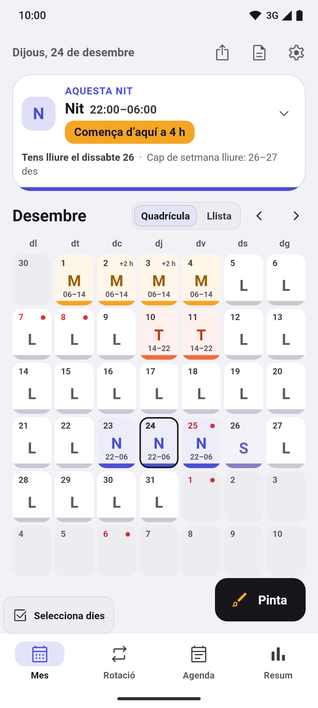</a>
  <a href="docs/readme/ca/02-lista.png">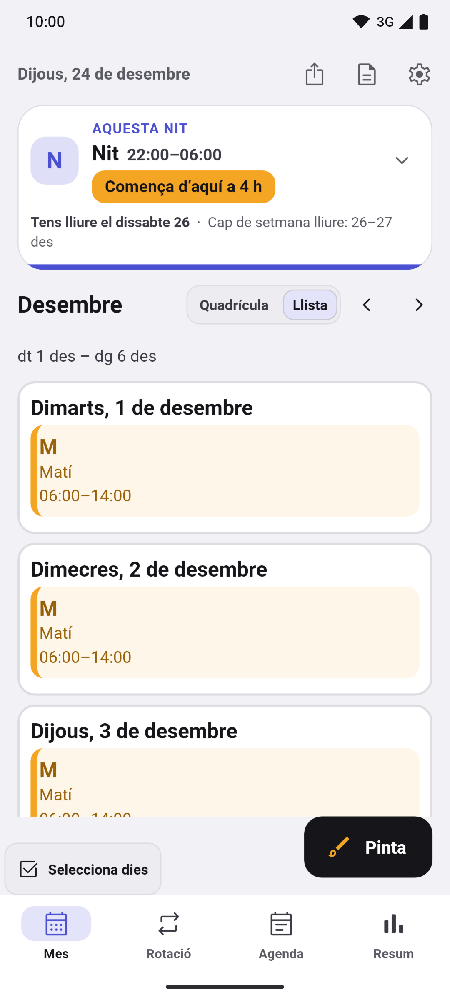</a>
  <a href="docs/readme/ca/03-pintar.png">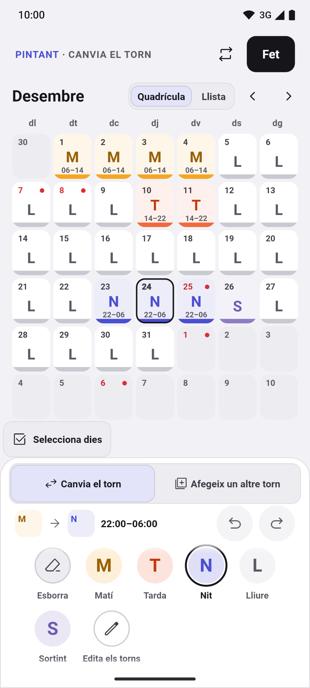</a>
  <a href="docs/readme/ca/04-rotaciones.png">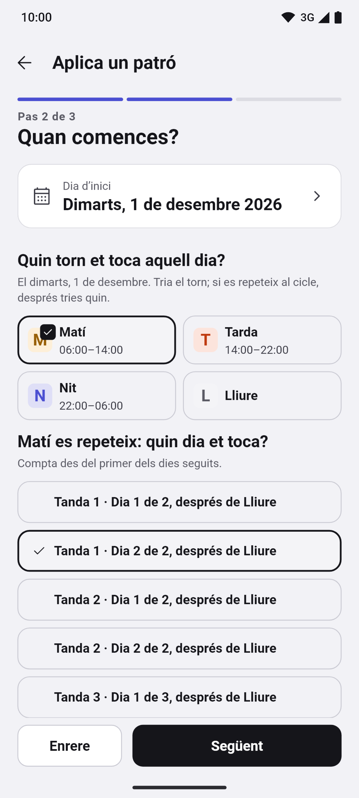</a>
  <a href="docs/readme/ca/05-horas.png">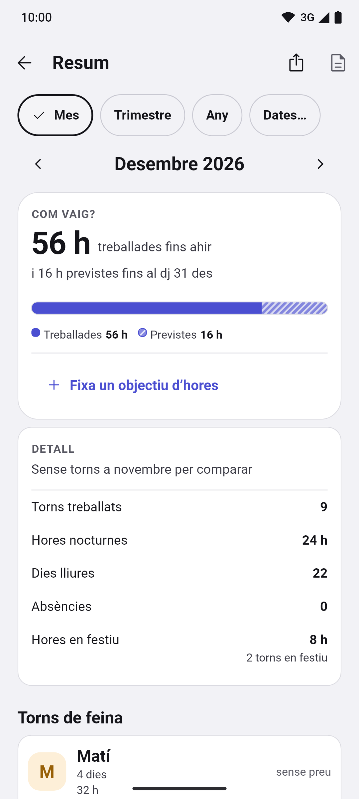</a>

Més captures

  <a href="docs/readme/ca/06-festivos.png">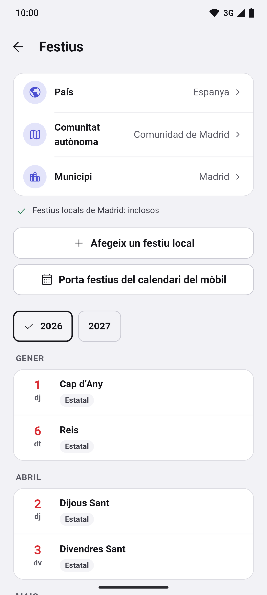</a>
  <a href="docs/readme/ca/07-mes-oscuro.png">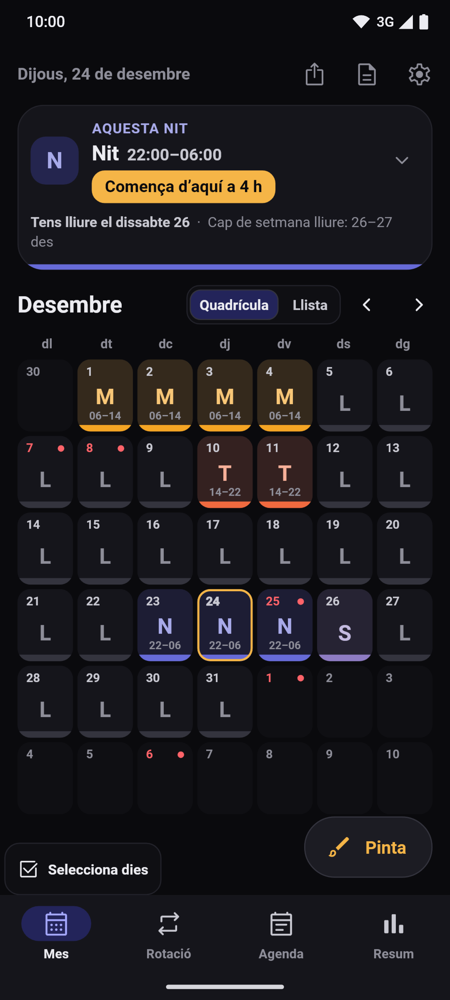</a>
  <a href="docs/readme/ca/08-vacaciones.png">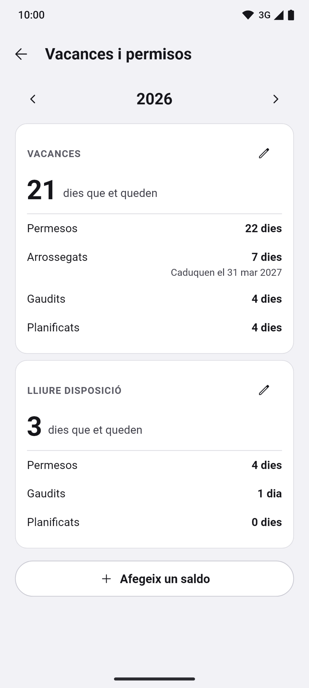</a>
  <a href="docs/readme/ca/09-cambios.png">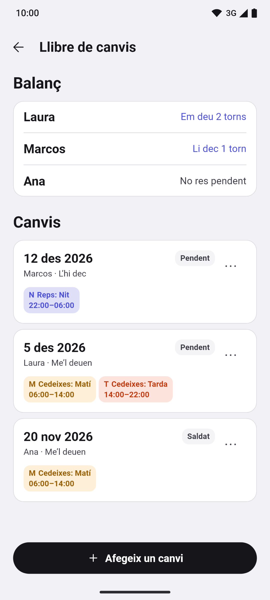</a>
  <a href="docs/readme/ca/10-primer-uso.png">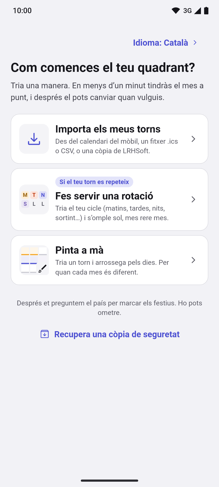</a>
  <a href="docs/readme/ca/11-widgets.png">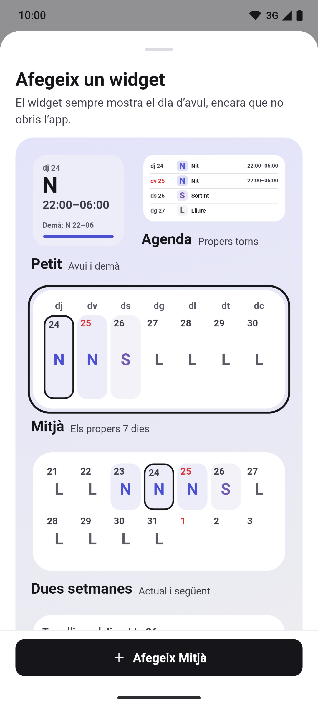</a>

Prem una captura per ampliar-la. Pantalles reals amb dades fictícies, generades
per [tests de Flutter](app/test/store/), també [en castellà](README.es.md#capturas).

## Funcions

- **Mes, rotació, agenda i resum.** Barra inferior (Mes · Rotació · Agenda ·
  Resum) i targeta d’avui plegable amb el proper torn, el proper dia lliure i la
  ratxa. Cada torn porta color, codi i horari, en quadrícula o llista, amb vista
  anual i notes per dia. Sota el mes, una franja amb els torns, les hores respecte
  de l’objectiu i el proper dia lliure; toca-la per obrir el resum d’aquell mes.
- **Pintar torns i rotacions.** Toca o arrossega per seleccionar diversos dies,
  doblar, copiar i enganxar, desfer i refer; assistent de rotacions amb vista
  prèvia: torns rotatius, 24/72, 4×4, 6×4, 5×2, 2-2-3, «2 i 2», «3 i 1» i patrons
  propis. En les dues noves tries el torn de treball. Tipus de torn, colors,
  icones i horaris editables.
- **Festius per país.** Espanya amb les seves comunitats i municipis, i 21 països
  més (Portugal, Brasil, Llatinoamèrica, Europa, Estats Units i Canadà), tot
  sense connexió, a més dels que hi afegeixis tu.
- **Alarmes, widgets i no molestar.** Alarma per tipus de torn, recordatoris de
  notes i widgets d’Android, inclòs un de quatre setmanes. Mostren extres i
  sortides anticipades; el de set dies suma les hores. A Android, «Silencia
  el mòbil durant els meus torns» el silencia mentre treballes. La puntualitat
  depèn dels permisos i les restriccions del sistema. A l’iPhone també hi ha
  widgets, a la pantalla d’inici i a la de bloqueig.
- **Còpia, informes i calendari del mòbil.** Còpies de seguretat locals
  automàtiques i, a Android, una còpia diària a la carpeta que triïs (Drive,
  Dropbox, OneDrive o el mòbil), amb vista prèvia en restaurar i «Prova la
  restauració». Informes en PDF i CSV d’un mes o de les dates que vulguis,
  «Mantenir al dia» per seguir els teus torns al calendari del mòbil, i
  importació des de LRHSoft, `.ics`, CSV i el calendari del mòbil.
- **Hores, diners i permisos.** Hores treballades, nocturnes i festives, sortides
  anticipades i extres per blocs, amb tipus i tarifa; tries si cada tipus compta
  per a l’objectiu d’hores. El Resum i el PDF mostren la ratxa més llarga de dies
  treballats seguits. Plusos de nit i de festiu per hora; estimació bruta i
  neta amb la retenció que posis. Saldos de vacances i permisos per any i tipus,
  amb els dies arrossegats i els que et queden.

Més funcions

- **Rotació des del dia.** Inicia, acaba o reprèn la rotació des del detall d’un
  dia, amb una explicació del que canvia i l’opció de desfer.
- **Llibre de canvis.** Anota un torn que cedeixis o rebis d’un company, mira el
  seu balanç («Em deu 2 torns», «Li dec 1 torn»), l’estat i els torns de cada
  canvi, i aplica’l al calendari amb un sol desfer.
- **Adjunts i tasques.** A «Més opcions» d’un dia, «Adjunts» desa les fotos, els
  dibuixos i els fitxers d’aquell dia, i «Tasques» n’és la llista de comprovació,
  cadascuna amb un desfer.
- **Comparar calendaris i cites del mòbil.** Fins a sis calendaris alhora i les
  cites del mòbil al costat dels teus torns; Turnly només les llegeix.
- **Aparença.** Colors d’accent, paletes preparades, imatge de fons del
  calendari, la primera línia de la nota a la casella del mes, un clic en pintar
  i el codi del torn més gran.
- **Diversos calendaris.** Tots els que vulguis, cadascun amb les seves rotacions
  i els seus dies.
- **Accessibilitat.** Selector d’idioma, lector de pantalla, text ampliable i
  torns que no depenen mai només del color.

## Privacitat

Els torns i la configuració es desen al mòbil. Sense servidor propi, analítica,
seguiment ni enviament d’informes d’errors. L’app demana permís de **calendari** en
importar o exportar, i de **notificacions i alarmes** en activar els avisos.

Permisos i còpies

No demana ubicació, contactes, càmera ni micròfon.

Les còpies del sistema de Google o Apple poden incloure les teves dades, també les
absències. Si exportes a un calendari sincronitzat o comparteixes una còpia, les
dades van a la destinació que triïs. El fitxer de còpia `.turnly` no està xifrat.

[Web](https://turnly.mainshai.com/ca/) · [Política de privacitat](https://turnly.mainshai.com/ca/privacy/) ·
[Detall tècnic](docs/privacy.md) (en castellà) · Suport: **turnly@mainshai.com**.

## Novetats

- **1.1.0 (13-nov-2026):** l’iPhone rep tot el de la 0.10.0: hores extra per blocs, accions de rotació des del dia, la franja del mes, la teva ratxa més llarga i les rotacions noves. Els widgets d’iPhone mostren les hores extra i el total de set dies.
- **0.10.0 (12-nov-2026):** hores extra per blocs amb tipus i tarifa, i accions de rotació des del dia. Franja del mes amb el proper dia lliure, ratxa més llarga al Resum, widgets d’Android amb extres i total de set dies, i rotacions «2 i 2» / «3 i 1».
- **1.0.0 (10-nov-2026):** primera versió a l’App Store, per a iPhone. Android continua en proves a Google Play.

Els canvis de cada versió són al [CHANGELOG.md](CHANGELOG.md) i a les
[versions publicades](https://github.com/dferrandizmont/turnly/releases).

## Contribuir

Els informes d’errors, les idees i les traduccions són benvinguts. Com compilar,
provar i col·laborar: [CONTRIBUTING.es.md](CONTRIBUTING.es.md).

## Llicència

Codi [MIT](LICENSE), Copyright (c) 2026 Daniel Mont Ferrandiz. Contingut propi
[CC BY-SA 4.0](LICENSE-CONTENT.md). Les fonts oficials de festius i els materials
de tercers conserven les seves condicions, detallades en aquestes llicències.

Per comunicar una vulnerabilitat: [SECURITY.md](SECURITY.md).
