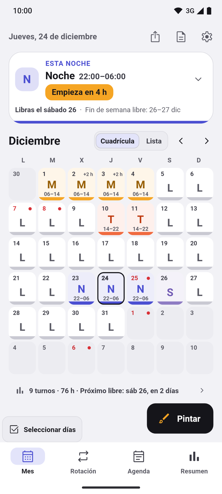
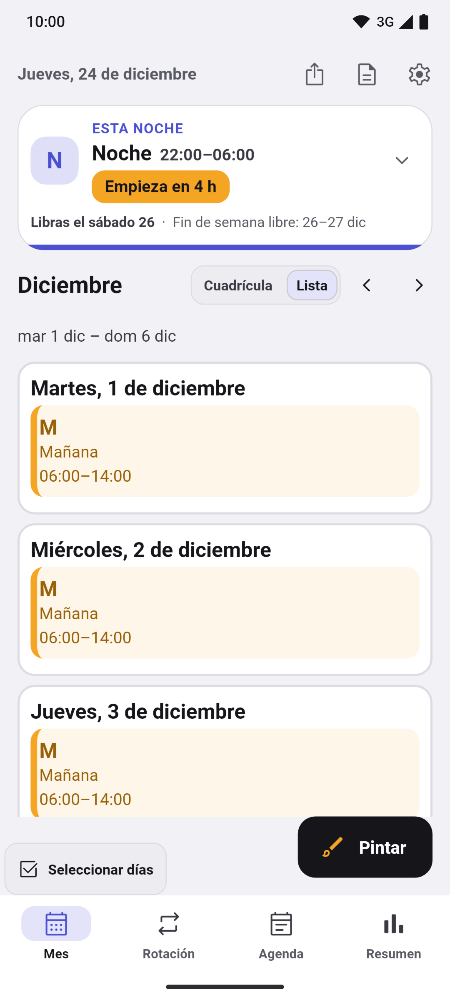
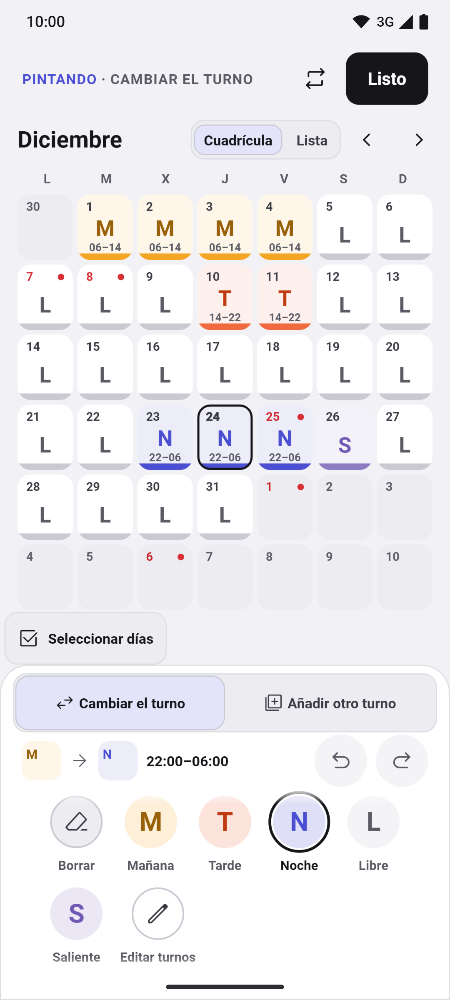
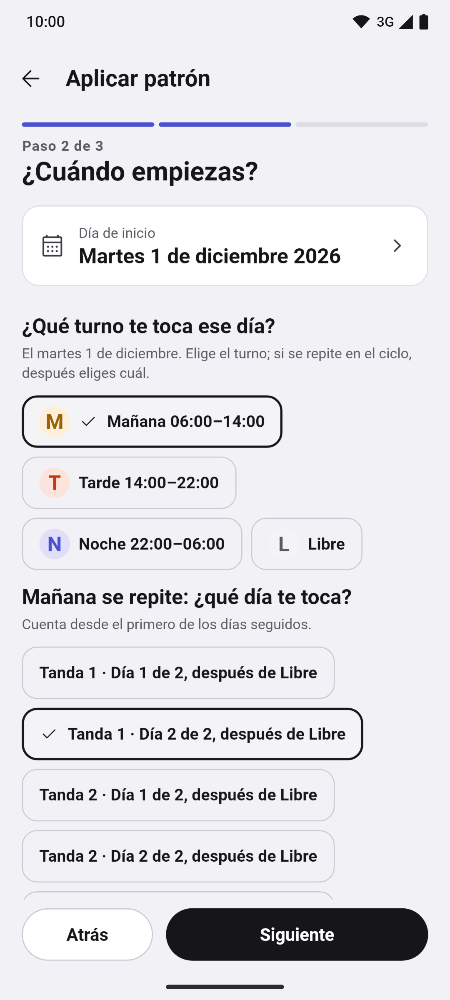
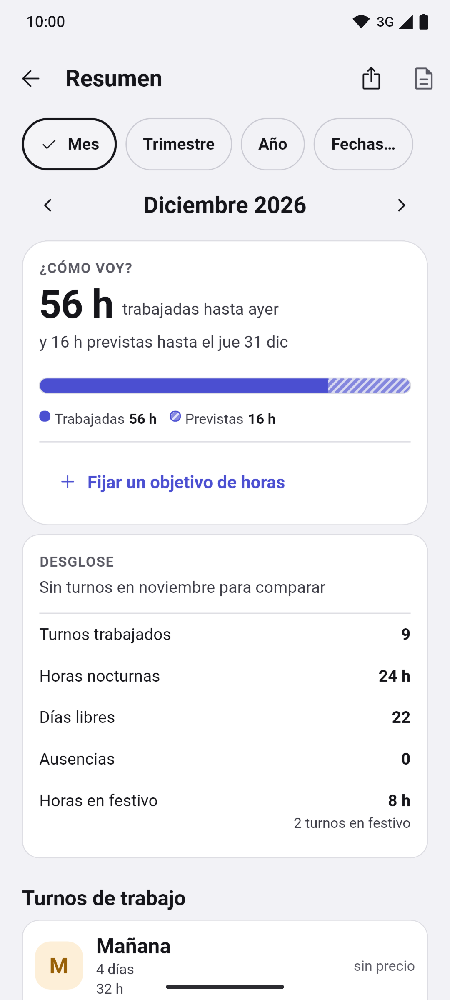
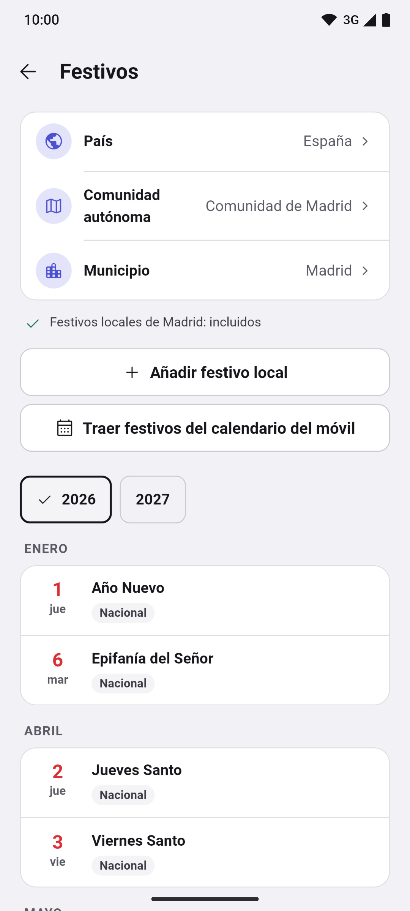
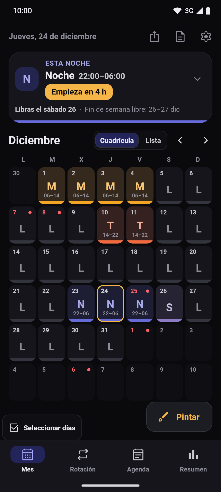
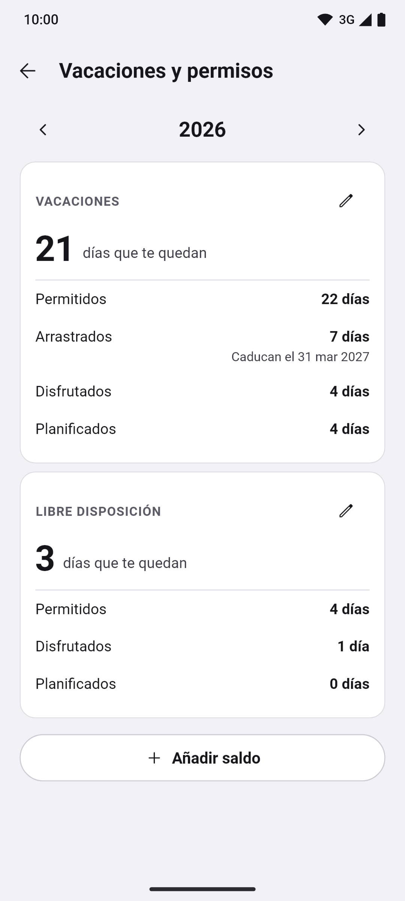
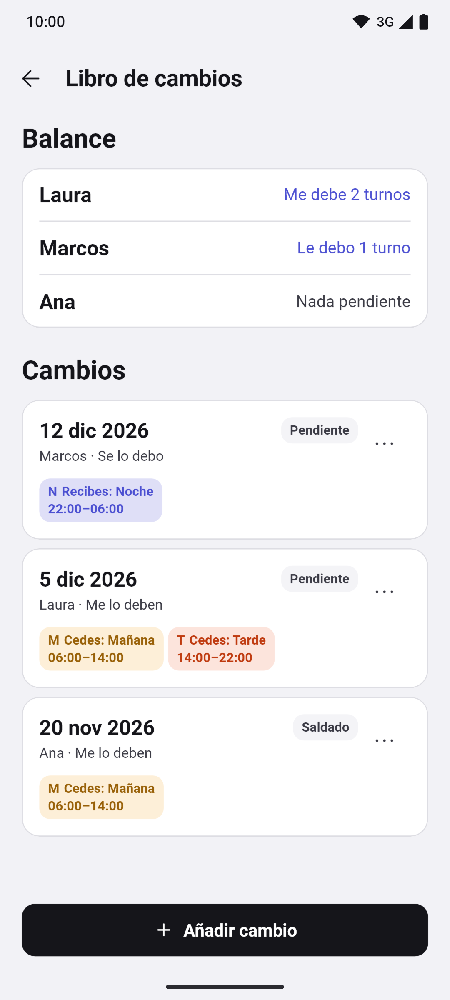

[English](README.md) · **Español** · [Català](README.ca.md) · [Galego](README.gl.md) · [Euskara](README.eu.md)

  

# Turnly

Antes se llamaba Cuadrante.

Calendario de turnos para quienes trabajan a turnos en España: sanidad, policía,
bomberos, industria, hostelería o cualquier otro sector. Organiza mañanas, tardes,
noches, guardias y días libres, y consulta el próximo turno de un vistazo. Cinco
idiomas: español, català, galego, euskara y English.

**Gratis · Sin anuncios · Sin cuenta · Funciona sin conexión · Código abierto**

Todas las funciones disponibles están abiertas, sin Pro ni compras dentro de
la app.

## Descargas

  
  
  <!--
  
  -->

Android en pruebas; iPhone, próximamente. Modo claro y oscuro.

Únete a la beta de Google Play

La app está en prueba cerrada en Google Play y cualquiera puede apuntarse:

1. Únete al grupo de testers: [turnly-testers](https://groups.google.com/g/turnly-testers). Con tu cuenta de Google, pulsa «Unirse al grupo».
2. Acepta la prueba desde el móvil o el ordenador: [play.google.com/apps/testing/es.cuadrante.app](https://play.google.com/apps/testing/es.cuadrante.app).
3. Instala la app desde Google Play. Se actualizará sola.

Si puedes, quédate en la prueba al menos 14 días y úsala de vez en cuando (por ejemplo, mira tu turno de mañana o pon el widget): Google exige 12 testers durante 14 días para publicarla para todo el mundo. Los comentarios, a turnly@mainshai.com.

Instala el APK desde GitHub

También puedes descargar el APK de la [última versión](https://github.com/dferrandizmont/turnly/releases/latest) e instalarlo a mano (hay que permitir «instalar aplicaciones de origen desconocido»). Desde la 0.8.3 va firmado con la misma clave que la versión de Google Play, así que puedes pasar de una a otra sin desinstalar y sin perder nada; Android solo no deja volver a una versión más antigua. Si instalaste Turnly desde Google Play antes de la 0.8.3, desinstálala una vez (exporta antes una copia desde la app: `.turnly`; las versiones anteriores la guardan como `.cuadrante`).

## Capturas

  
  
  
  
  

Más capturas

  
  
  
  

Pulsa una captura para ampliarla. Pantallas reales con datos ficticios, generadas
por [tests de Flutter](app/test/store/), también [en inglés](README.md#screenshots).

## Funciones

- **Mes, rotación, agenda y resumen.** Barra inferior (Mes · Rotación · Agenda ·
  Resumen) y tarjeta de hoy plegable con el próximo turno, el próximo día libre y
  la racha. Cada turno lleva color, código y horario, en cuadrícula o lista, con
  vista anual y notas por día.
- **Pintar turnos y rotaciones.** Toca o arrastra para seleccionar varios días,
  doblar, copiar y pegar, deshacer y rehacer; asistente de rotaciones con vista
  previa: correturnos, 24/72, 4×4, 6×4, 5×2, 2-2-3 y patrones propios. Tipos de
  turno, colores, iconos y horarios editables.
- **Festivos por país.** España con sus comunidades y municipios, y 21 países más
  (Portugal, Brasil, Latinoamérica, Europa, Estados Unidos y Canadá), todo sin
  conexión, además de los que añadas tú.
- **Alarmas, widgets y no molestar.** Alarma por tipo de turno, recordatorios de
  notas y widgets de Android, incluido uno de cuatro semanas. En Android,
  «Silenciar el móvil en mis turnos» lo silencia mientras trabajas. La puntualidad
  depende de los permisos y las restricciones del sistema. El widget de iPhone está
  pendiente.
- **Copia, informes y calendario del móvil.** Copias de seguridad locales
  automáticas y, en Android, una copia diaria en la carpeta que elijas (Drive,
  Dropbox, OneDrive o el móvil), con vista previa al restaurar y «Probar
  restauración». Informes en PDF y CSV de un mes o de las fechas que quieras,
  «Mantener al día» para seguir tus turnos en el calendario del móvil, e
  importación desde LRHSoft, `.ics`, CSV y el calendario del móvil.
- **Horas, dinero y permisos.** Horas trabajadas, nocturnas y festivas, extras y
  salidas anticipadas; pluses de noche y de festivo por hora; estimación bruta y
  neta con la retención que pongas. Saldos de vacaciones y permisos por año y tipo,
  con los días arrastrados y los que te quedan.

Más funciones

- **Libro de cambios.** Anota un turno que cedas o recibas de un compañero, mira
  su balance («Me debe 2 turnos», «Le debo 1 turno»), el estado y los turnos de
  cada cambio, y aplícalo al calendario con un solo deshacer.
- **Adjuntos y tareas.** En «Más opciones» de un día, «Adjuntos» guarda sus fotos,
  dibujos y archivos, y «Tareas» es su lista de comprobación, cada una con un
  deshacer.
- **Comparar calendarios y citas del móvil.** Hasta seis calendarios a la vez y
  las citas de tu móvil junto a tus turnos; Turnly solo las lee.
- **Apariencia.** Colores de acento, paletas preparadas, imagen de fondo del
  calendario, la primera línea de la nota en la casilla del mes, un clic al pintar
  y el código del turno más grande.
- **Varios calendarios.** Todos los que quieras, cada uno con sus rotaciones y sus
  días.
- **Accesibilidad.** Selector de idioma, lector de pantalla, texto ampliable y
  turnos que nunca dependen solo del color.

## Privacidad

Los turnos y ajustes se guardan en el móvil. Sin servidor propio, analítica,
rastreo ni envío de informes de errores. La app pide permiso de **calendario** al
importar o exportar, y de **notificaciones y alarmas** al activar los avisos.

Permisos y copias

No pide ubicación, contactos, cámara ni micrófono.

Las copias del sistema de Google o Apple pueden incluir tus datos, también las
ausencias. Si exportas a un calendario sincronizado o compartes una copia, los
datos van al destino que elijas. El archivo de copia `.turnly` no está cifrado.

[Web](https://turnly.mainshai.com) · [Política de privacidad](https://turnly.mainshai.com/privacy/) ·
[Detalle técnico](docs/privacy.md) · Soporte: **turnly@mainshai.com**.

## Novedades

Lo que cambia en cada versión está en [CHANGELOG.md](CHANGELOG.md) y en las
[versiones publicadas](https://github.com/dferrandizmont/turnly/releases).

## Contribuir

Son bienvenidos los informes de errores, las ideas y las traducciones. Cómo
compilar, probar y contribuir: [CONTRIBUTING.es.md](CONTRIBUTING.es.md).

## Licencia

Código [MIT](LICENSE), Copyright (c) 2026 Daniel Mont Ferrandiz. Contenido propio
[CC BY-SA 4.0](LICENSE-CONTENT.md). Las fuentes oficiales de festivos y los
materiales de terceros conservan sus condiciones, detalladas en esas licencias.

Para comunicar una vulnerabilidad: [SECURITY.md](SECURITY.md).
