[English](README.md) · [Español](README.es.md) · [Català](README.ca.md) · [Galego](README.gl.md) · **Euskara**

  

# Turnly

Lehen Cuadrante zuen izena.

Txanden egutegia Espainian txandaka lan egiten dutenentzat: osasungintza, polizia,
suhiltzaileak, industria, ostalaritza edo beste edozein sektore. Antolatu goizak,
arratsaldeak, gauak, guardiak eta egun libreak, eta ikusi hurrengo txanda begi-kolpe
batean. Bost hizkuntza: español, català, galego, euskara eta English.

**Doakoa · Iragarkirik gabe · Konturik gabe · Konexiorik gabe · Kode irekia**

Eskuragarri dauden funtzio guztiak irekita daude, Pro bertsiorik eta aplikazio
barneko erosketarik gabe.

## Deskargak

  
  
  

Android probetan; iPhone, App Store-n. Modu argia eta iluna.

Sartu Google Play-ko betan

Aplikazioa proba itxian dago Google Play-n, eta edonor sar daiteke:

1. Sartu testerren taldean: [turnly-testers](https://groups.google.com/g/turnly-testers). Zure Google kontuarekin, sakatu taldean sartzeko botoia.
2. Onartu proba mugikorretik edo ordenagailutik: [play.google.com/apps/testing/es.cuadrante.app](https://play.google.com/apps/testing/es.cuadrante.app).
3. Instalatu aplikazioa Google Play-tik. Bere kabuz eguneratuko da.

Ahal baduzu, egon proban gutxienez 14 egunez eta erabili noizean behin (adibidez, begiratu biharko txanda edo jarri widgeta): Google-k 12 tester eskatzen ditu 14 egunez, aplikazioa guztientzat argitaratzeko. Iruzkinak, turnly@mainshai.com helbidera.

Instalatu APKa GitHub-etik

[Azken bertsioaren](https://github.com/dferrandizmont/turnly/releases) APKa ere deskarga dezakezu eta eskuz instalatu (jatorri ezezaguneko aplikazioak instalatzea baimendu behar da). 0.8.3 bertsiotik aurrera Google Play-ko bertsioaren gako berarekin dago sinatuta; beraz, batetik bestera pasa zaitezke desinstalatu gabe eta ezer galdu gabe; Android-ek bertsio zaharrago batera itzultzea bakarrik ez du uzten. Turnly Google Play-tik 0.8.3 baino lehen instalatu bazenuen, desinstalatu behin (esportatu lehenago kopia bat aplikaziotik: `.turnly`; aurreko bertsioek `.cuadrante` gisa gordetzen dute).

## Pantaila-argazkiak

  <a href="docs/readme/eu/01-mes.png">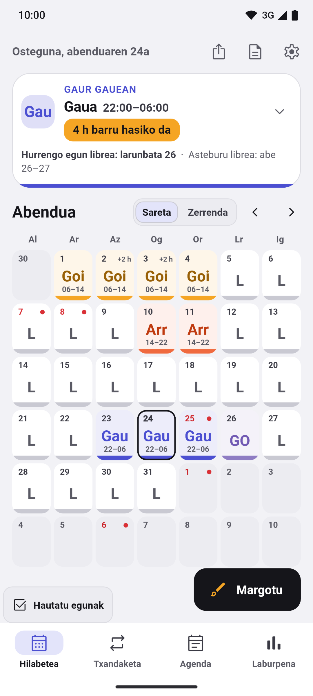</a>
  <a href="docs/readme/eu/02-lista.png">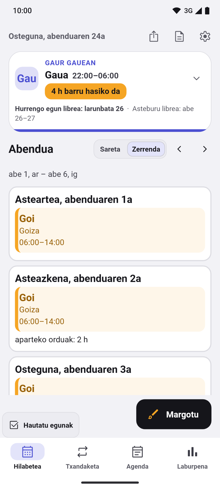</a>
  <a href="docs/readme/eu/03-pintar.png">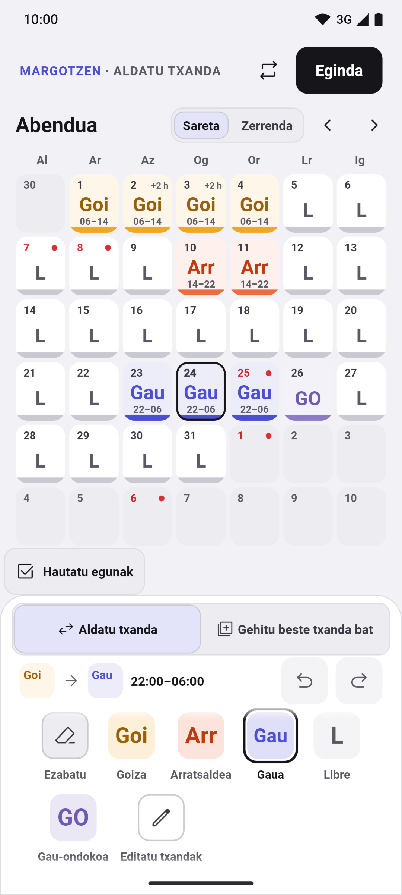</a>
  <a href="docs/readme/eu/04-rotaciones.png">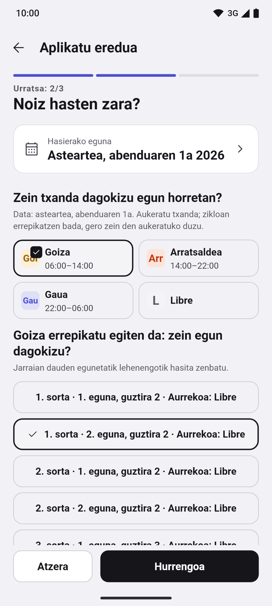</a>
  <a href="docs/readme/eu/05-horas.png">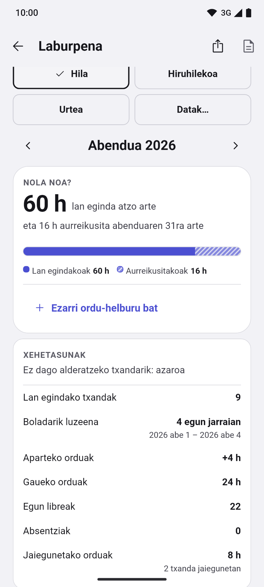</a>

Pantaila-argazki gehiago

  <a href="docs/readme/eu/06-festivos.png">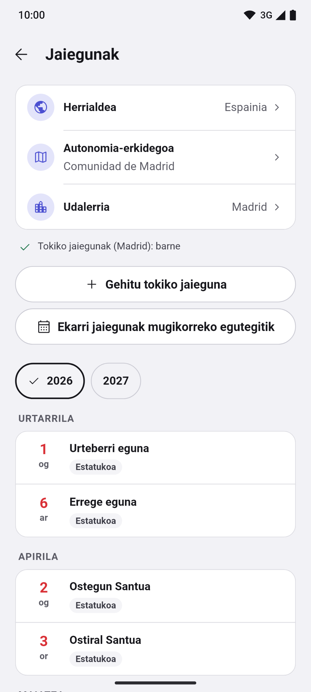</a>
  <a href="docs/readme/eu/07-mes-oscuro.png">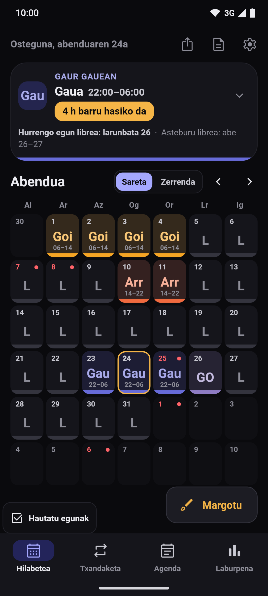</a>
  <a href="docs/readme/eu/08-vacaciones.png">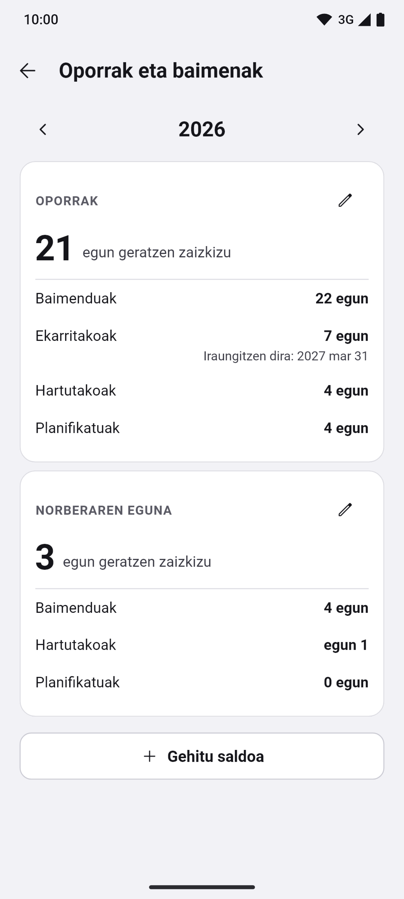</a>
  <a href="docs/readme/eu/09-cambios.png">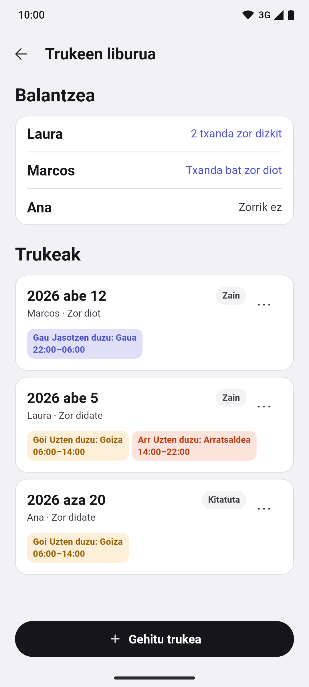</a>
  <a href="docs/readme/eu/10-primer-uso.png">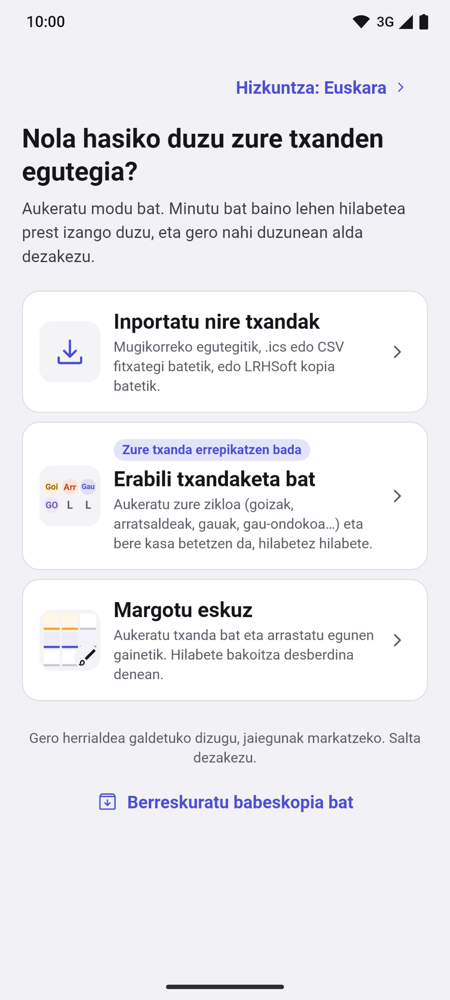</a>
  <a href="docs/readme/eu/11-widgets.png">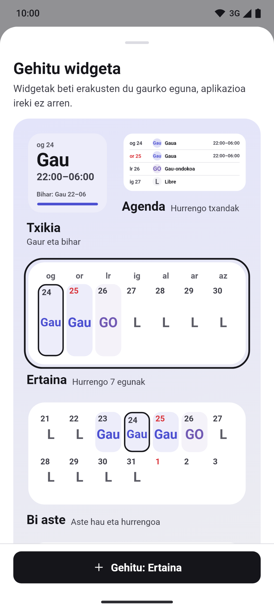</a>

Sakatu pantaila-argazki bat handitzeko. Benetako pantailak dira, datu asmatuekin, eta
[Flutter-en testek](app/test/store/) sortzen dituzte; [gaztelaniaz](README.es.md#capturas) ere badaude.

## Funtzioak

- **Hilabetea, txandaketa, agenda eta laburpena.** Beheko barra (Hilabetea ·
  Txandaketa · Agenda · Laburpena) eta gaurko txartel tolesgarria, hurrengo
  txandarekin, hurrengo egun librearekin eta lan-boladarekin. Txanda bakoitzak
  kolorea, kodea eta ordutegia ditu, saretan edo zerrendan, urteko ikuspegiarekin
  eta eguneko oharrekin. Hilabetearen azpiko zerrendan, txandak, orduak helburuarekin
  alderatuta eta hurrengo egun librea; ukitu hilabeteko laburpena irekitzeko.
- **Txandak eta txandaketak margotzea.** Ukituz edo arrastatuz, hainbat egun
  hautatu, bikoiztu, kopiatu eta itsatsi, desegin eta berregin; txandaketen
  laguntzailea aurrebistarekin: txanda birakariak, 24/72, 4×4, 6×4, 5×2, 2-2-3
  eta «2 eta 2», «3 eta 1» nahiz eredu propioak. Bi berrietan laneko txanda zuk
  aukeratzen duzu. Txanda motak, koloreak, ikonoak eta ordutegiak editagarriak
  dira.
- **Jaiegunak herrialdeka.** Espainia, bere erkidego eta udalerriekin, eta beste 21
  herrialde (Portugal, Brasil, Latinoamerika, Europa, Ameriketako Estatu Batuak eta
  Kanada), dena konexiorik gabe, zuk gehitzen dituzunez gain.
- **Alarmak, widgetak eta ez molestatu.** Alarmak txanda motaren arabera, oharren
  gogorarazpenak eta Androiderako widgetak, lau astekoa barne. Aparteko orduak eta
  irteera aurreratuak erakusten dituzte; zazpi egunekoak orduak batzen ditu.
  Androiden, «Isildu mugikorra nire txandetan» aukerak mugikorra isilarazten du
  lanean ari zaren bitartean. Puntualtasuna sistemaren baimenen eta murrizketen araberakoa da.
  iPhonen ere badaude widgetak, hasierako pantailan eta blokeo-pantailan.
- **Babeskopia, txostenak eta mugikorreko egutegia.** Tokiko babeskopia automatikoak
  eta, Androiden, eguneroko kopia bat zuk aukeratutako karpetan (Drive, Dropbox,
  OneDrive edo mugikorra), leheneratu aurreko aurrebistarekin eta «Probatu
  leheneratzea». Hilabete baten edo nahi dituzun daten PDF eta CSV txostenak,
  «Eguneratuta mantendu» zure txandak mugikorreko egutegian jarraitzeko, eta
  LRHSoft-etik, `.ics` eta CSV fitxategietatik eta mugikorreko egutegitik
  inportatzea.
- **Orduak, dirua eta baimenak.** Lan egindako, gaueko eta jaiegunetako orduak,
  irteera aurreratuak eta aparteko orduak blokeka, motekin eta tarifarekin;
  mota bakoitza ordu-helbururako zenbatu ala ez aukeratzen duzu. Laburpenak eta
  PDF txostenak jarraian lan egindako egunen boladarik luzeena erakusten dute.
  Orduko gaueko eta jaiegunetako osagarriak; eta soldata gordinaren eta garbiaren
  estimazioa, zuk jarritako atxikipenarekin. Oporren eta baimenen saldoak urte eta motaren arabera,
  eramandako egunekin eta gelditzen zaizkizunekin.

Funtzio gehiago

- **Txandaketa egunetik.** Egun baten xehetasunetan, txandaketa hasteko, amaitzeko
  edo berriz hasteko aukerak dituzu; aukera bakoitzak zer aldatuko den azaltzen du, eta aldaketa desegin dezakezu.
- **Trukeen liburua.** Idatzi lankide bati eman edo lankide batengandik jaso duzun
  txanda bat, ikusi haren balantzea («2 txanda zor dizkit», «Txanda bat zor
  diot»), truke bakoitzaren egoera eta txandak, eta aplikatu egutegira desegite
  bakarrarekin.
- **Eranskinak eta zereginak.** Egun bateko «Aukera gehiago» atalean, «Eranskinak»
  atalak egun horretako argazkiak, marrazkiak eta fitxategiak gordetzen ditu, eta
  «Zereginak» egun horretako egiaztapen-zerrenda da, bakoitza desegite batekin.
- **Egutegiak eta mugikorreko hitzorduak alderatzea.** Gehienez sei egutegi aldi
  berean, eta mugikorreko hitzorduak zure txandekin batera; Turnly-k irakurri
  bakarrik egiten ditu.
- **Itxura.** Azentu-koloreak, prestatutako paletak, egutegiko atzeko irudia,
  oharraren lehen lerroa hilabeteko laukian, klik bat margotzean eta txandaren
  kode handiagoa.
- **Hainbat egutegi.** Nahi adina, bakoitza bere txandaketekin eta egunekin.
- **Irisgarritasuna.** Hizkuntza-hautatzailea, pantaila-irakurgailua eta testu
  handigarria; txandak ez daude inoiz kolorearen mende bakarrik.

## Pribatutasuna

Txandak eta ezarpenak mugikorrean gordetzen dira. Ez dago zerbitzari propiorik,
analitikarik, jarraipenik ezta errore-txostenen bidalketarik ere. Aplikazioak
**egutegirako** baimena eskatzen du inportatzean edo esportatzean, eta
**jakinarazpenetarako eta alarmetarako** baimena abisuak aktibatzean.

Baimenak eta kopiak

Ez du kokapenik, kontakturik, kamerarik ezta mikrofonorik eskatzen.

Google-ren edo Apple-ren sistemako kopiek zure datuak izan ditzakete, absentziak
barne. Sinkronizatutako egutegi batera esportatzen baduzu edo kopia bat partekatzen
baduzu, datuak zuk aukeratutako helmugara joaten dira. `.turnly` kopia-fitxategia ez
dago zifratuta.

[Webgunea](https://turnly.mainshai.com/eu/) · [Pribatutasun-politika](https://turnly.mainshai.com/eu/privacy/) ·
[Xehetasun teknikoak](docs/privacy.md) (gaztelaniaz) · Laguntza: **turnly@mainshai.com**.

## Berriak

- **1.1.0 (2026-11-13):** orain iPadean ere bai. iPhoneak eta iPadak 0.10.0ko guztia jasotzen dute: aparteko orduak blokeka, txandaketarako ekintzak egunetik, hilabetearen azpiko zerrenda, lan-boladarik luzeena eta txandaketa berriak. iPhoneko widgetek aparteko orduak eta zazpi eguneko guztizkoa erakusten dituzte.
- **0.10.0 (2026-11-12):** aparteko orduak blokeka, motekin eta tarifarekin, eta txandaketarako ekintzak egunetik. Hilabetearen azpiko zerrenda hurrengo egun librearekin, lan-boladarik luzeena Laburpenean, aparteko orduak eta zazpi eguneko guztizkoa Android widgetetan, eta «2 eta 2» / «3 eta 1» txandaketak.
- **1.0.0 (2026-11-10):** lehen bertsioa App Store-n, iPhonerako. Androidek Google Playko probetan jarraitzen du.

Zer aldatu den bertsio bakoitzean [CHANGELOG.md](CHANGELOG.md) eta
[argitalpenetan](https://github.com/dferrandizmont/turnly/releases) dago.

## Lagundu

Akatsen berriak, ideiak eta itzulpenak onartzen ditugu. Nola konpilatu, probatu
eta lagundu: [CONTRIBUTING.es.md](CONTRIBUTING.es.md).

## Lizentziak

Kodea: [MIT](LICENSE), Copyright (c) 2026 Daniel Mont Ferrandiz. Eduki propioa:
[CC BY-SA 4.0](LICENSE-CONTENT.md). Jaiegunen iturri ofizialek eta hirugarrenen
materialek beren baldintzak dituzte, lizentzia horietan zehaztuta.

Ahultasun baten berri emateko: [SECURITY.md](SECURITY.md).
