[English](README.md) · [Español](README.es.md) · [Català](README.ca.md) · **Galego** · [Euskara](README.eu.md)

  

# Turnly

Antes chamábase Cuadrante.

Calendario de quendas para quen traballa a quendas en España: sanidade, policía,
bombeiros, industria, hostalaría ou calquera outro sector. Organiza mañás, tardes,
noites, gardas e días libres, e consulta a próxima quenda dunha ollada. Cinco
idiomas: español, català, galego, euskara e English.

**Gratis · Sen anuncios · Sen contas · Sen conexión · Código aberto**

Todas as funcións dispoñibles están abertas, sen Pro nin compras dentro da app.

## Descargas

  
  
  

Android en probas; iPhone, na App Store. Modo claro e escuro.

Únete á beta de Google Play

A app está en proba pechada en Google Play e calquera pode apuntarse:

1. Únete ao grupo de testers: [turnly-testers](https://groups.google.com/g/turnly-testers). Coa túa conta de Google, preme «Unirse ao grupo».
2. Acepta a proba desde o móbil ou o ordenador: [play.google.com/apps/testing/es.cuadrante.app](https://play.google.com/apps/testing/es.cuadrante.app).
3. Instala a app desde Google Play. Actualizarase soa.

Se podes, quédate na proba polo menos 14 días e úsaa de cando en vez (por exemplo, mira a túa quenda de mañá ou pon o widget): Google esixe 12 testers durante 14 días para publicala para todo o mundo. Os comentarios, a turnly@mainshai.com.

Instala o APK desde GitHub

Tamén podes descargar o APK da [última versión](https://github.com/dferrandizmont/turnly/releases) e instalalo á man (hai que permitir «instalar aplicacións de orixe descoñecida»). Desde a 0.8.3 vai asinado coa mesma clave que a versión de Google Play, así que podes pasar dunha á outra sen desinstalar e sen perder nada; Android só non deixa volver a unha versión máis antiga. Se instalaches Turnly desde Google Play antes da 0.8.3, desinstálaa unha vez (exporta antes unha copia desde a app: `.turnly`; as versións anteriores gárdana como `.cuadrante`).

## Capturas

  <a href="docs/readme/gl/01-mes.png">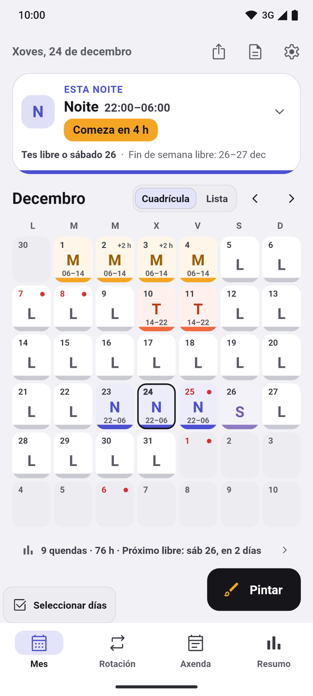</a>
  <a href="docs/readme/gl/02-lista.png">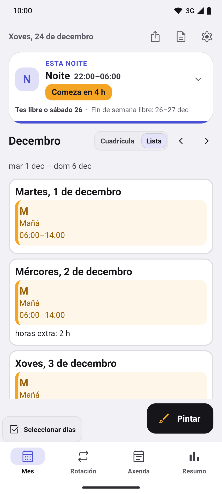</a>
  <a href="docs/readme/gl/03-pintar.png">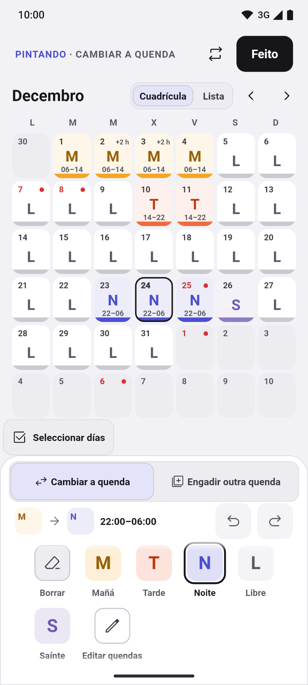</a>
  <a href="docs/readme/gl/04-rotaciones.png">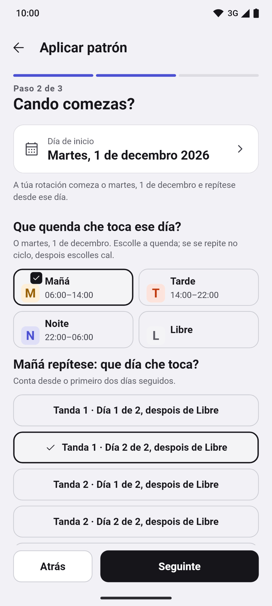</a>
  <a href="docs/readme/gl/05-horas.png">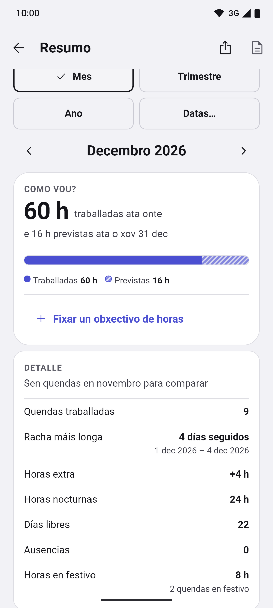</a>

Máis capturas

  <a href="docs/readme/gl/06-festivos.png">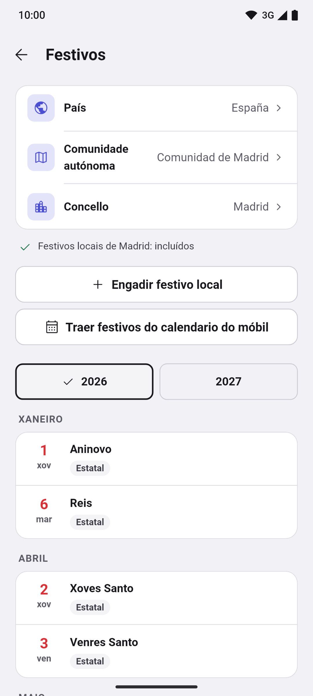</a>
  <a href="docs/readme/gl/07-mes-oscuro.png">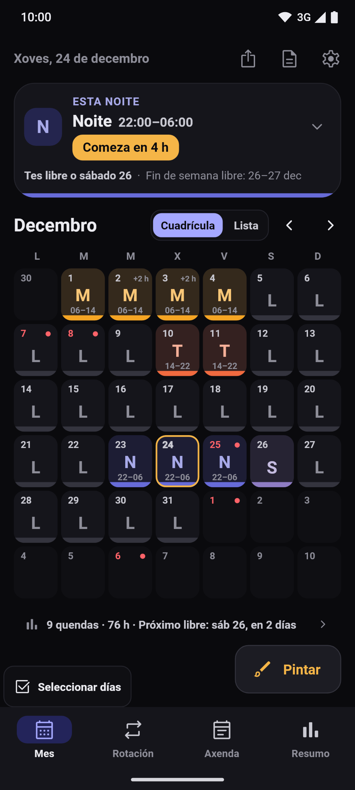</a>
  <a href="docs/readme/gl/08-vacaciones.png">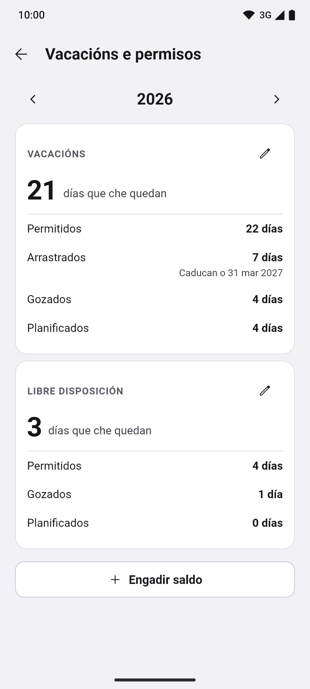</a>
  <a href="docs/readme/gl/09-cambios.png">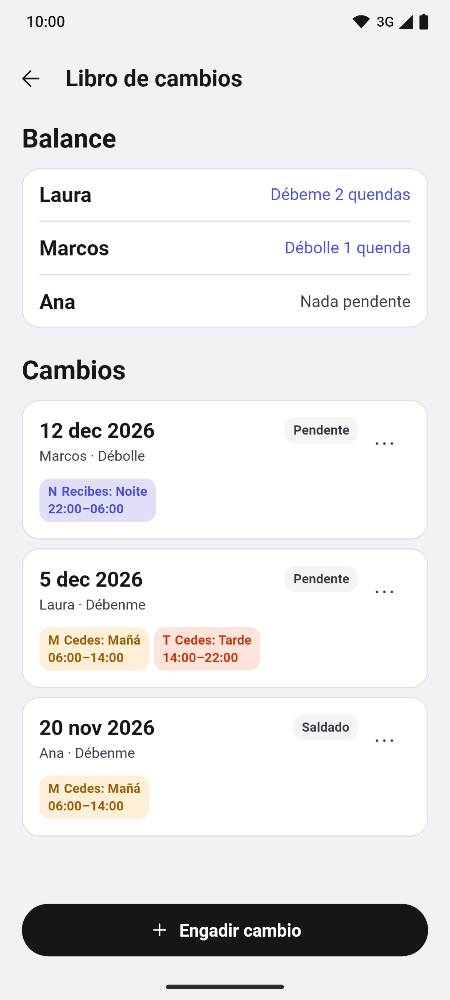</a>
  <a href="docs/readme/gl/10-primer-uso.png">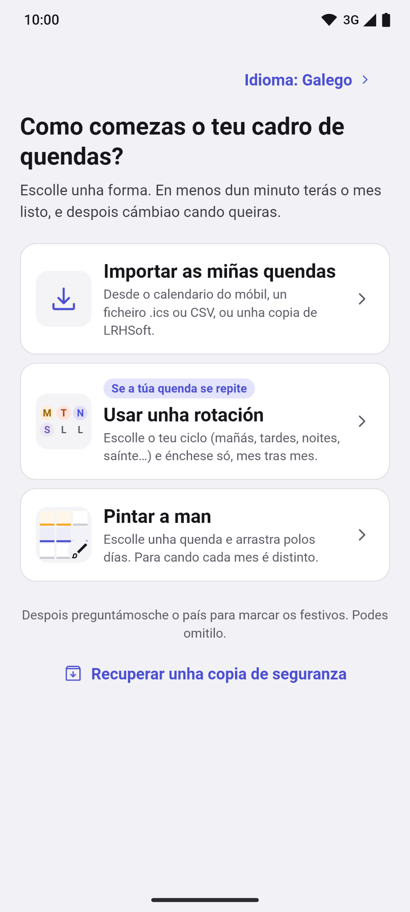</a>
  <a href="docs/readme/gl/11-widgets.png">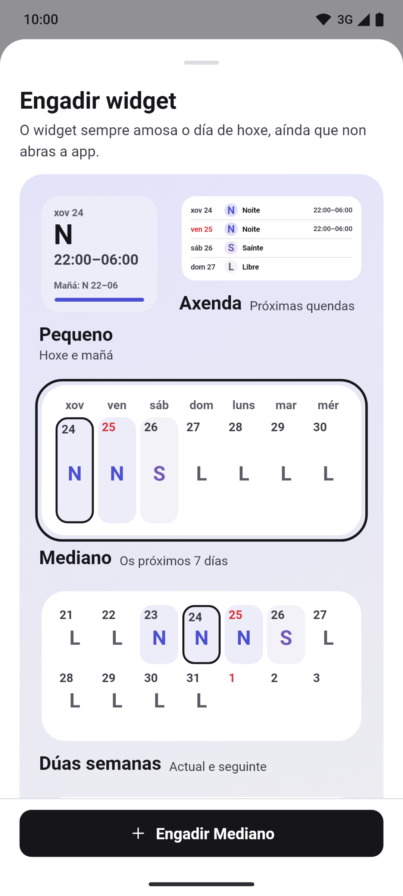</a>

Preme unha captura para ampliala. Pantallas reais con datos ficticios, xeradas
por [tests de Flutter](app/test/store/), tamén [en castelán](README.es.md#capturas).

## Funcións

- **Mes, rotación, axenda e resumo.** Barra inferior (Mes · Rotación · Axenda ·
  Resumo) e tarxeta de hoxe pregable coa próxima quenda, o próximo día libre e a
  racha. Cada quenda leva cor, código e horario, en cuadrícula ou lista, con
  vista anual e notas por día. Baixo o mes, unha tira coas quendas, horas fronte
  ao obxectivo e próximo día libre; tócaa para abrir o resumo dese mes.
- **Pintar quendas e rotacións.** Toca ou arrasta para seleccionar varios días,
  dobrar, copiar e pegar, desfacer e refacer; asistente de rotacións con vista
  previa: quendas rotativas, 24/72, 4×4, 6×4, 5×2, 2-2-3, «2 e 2», «3 e 1» e patróns
  propios. Nas dúas novas escolles a quenda de traballo.
  Tipos de quenda, cores, iconas e horarios editables.
- **Festivos por país.** España coas súas comunidades e municipios, e 21 países
  máis (Portugal, Brasil, Latinoamérica, Europa, Estados Unidos e Canadá), todo
  sen conexión, ademais dos que engadas ti.
- **Alarmas, widgets e non molestar.** Alarma por tipo de quenda, recordatorios
  de notas e widgets de Android, incluído un de catro semanas. Mostran extras e
  saídas anticipadas; o de sete días suma as horas. En Android,
  «Silenciar o móbil nas miñas quendas» silénciao mentres traballas. A
  puntualidade depende dos permisos e das restricións do sistema. No iPhone tamén
  hai widgets, na pantalla de inicio e na de bloqueo.
- **Copia, informes e calendario do móbil.** Copias de seguranza locais
  automáticas e, en Android, unha copia diaria na carpeta que escollas (Drive,
  Dropbox, OneDrive ou o móbil), con vista previa ao restaurar e «Probar
  restauración». Informes en PDF e CSV dun mes ou das datas que queiras, «Manter
  ao día» para seguir as túas quendas no calendario do móbil, e importación
  desde LRHSoft, `.ics`, CSV e o calendario do móbil.
- **Horas, diñeiro e permisos.** Horas traballadas, nocturnas e festivas, saídas
  anticipadas e extras por bloques, con tipos e tarifa; escolles se cada tipo conta
  para o obxectivo de horas. O Resumo e o PDF mostran a racha máis longa de días
  traballados seguidos. Pluses de noite e de festivo por hora; estimación bruta e
  neta coa retención que poñas. Saldos de vacacións e permisos por ano e tipo,
  cos días arrastrados e os que che quedan.

Máis funcións

- **Rotación desde o día.** Inicia, remata ou retoma a rotación desde o detalle
  dun día, cunha explicación do que cambia e a opción de desfacer.
- **Libro de cambios.** Anota unha quenda que cedas ou recibas dun compañeiro,
  mira o seu balance («Débeme 2 quendas», «Débolle 1 quenda»), o estado e as
  quendas de cada cambio, e aplícao ao calendario cun só desfacer.
- **Adxuntos e tarefas.** En «Máis opcións» dun día, «Adxuntos» garda as súas
  fotos, debuxos e ficheiros, e «Tarefas» é a súa lista de comprobación, cada
  unha cun desfacer.
- **Comparar calendarios e citas do móbil.** Ata seis calendarios á vez e as
  citas do móbil xunto ás túas quendas; Turnly só as le.
- **Aparencia.** Cores de acento, paletas preparadas, imaxe de fondo do
  calendario, a primeira liña da nota na casela do mes, un clic ao pintar e o
  código da quenda máis grande.
- **Varios calendarios.** Todos os que queiras, cada un coas súas rotacións e os
  seus días.
- **Accesibilidade.** Selector de idioma, lector de pantalla, texto ampliable e
  quendas que nunca dependen só da cor.

## Privacidade

As quendas e a configuración gárdanse no móbil. Sen servidor propio, analítica,
rastrexo nin envío de informes de erros. A app pide permiso de **calendario** ao
importar ou exportar, e de **notificacións e alarmas** ao activar os avisos.

Permisos e copias

Non pide localización, contactos, cámara nin micrófono.

As copias do sistema de Google ou Apple poden incluír os teus datos, tamén as
ausencias. Se exportas a un calendario sincronizado ou compartes unha copia, os
datos van ao destino que escollas. O ficheiro de copia `.turnly` non está cifrado.

[Web](https://turnly.mainshai.com/gl/) · [Política de privacidade](https://turnly.mainshai.com/gl/privacy/) ·
[Detalle técnico](docs/privacy.md) (en castelán) · Soporte: **turnly@mainshai.com**.

## Novidades

- **0.10.0 (12-nov-2026):** horas extra por bloques con tipos e tarifa, e accións de rotación desde o día. Tira do mes co próximo día libre, racha máis longa no Resumo, widgets de Android con extras e total de sete días, e rotacións «2 e 2» / «3 e 1».
- **1.0.0 (10-nov-2026):** primeira versión na App Store, para iPhone. Android segue en probas en Google Play.

O que cambia en cada versión está no [CHANGELOG.md](CHANGELOG.md) e nas
[versións publicadas](https://github.com/dferrandizmont/turnly/releases).

## Contribuír

Os informes de erros, as ideas e as traducións son benvidos. Como compilar,
probar e colaborar: [CONTRIBUTING.es.md](CONTRIBUTING.es.md).

## Licenzas

Código [MIT](LICENSE), Copyright (c) 2026 Daniel Mont Ferrandiz. Contido propio
[CC BY-SA 4.0](LICENSE-CONTENT.md). As fontes oficiais de festivos e os materiais
de terceiros conservan as súas condicións, detalladas nesas licenzas.

Para comunicar unha vulnerabilidade: [SECURITY.md](SECURITY.md).
