**English** · [Español](README.es.md) · [Català](README.ca.md) · [Galego](README.gl.md) · [Euskara](README.eu.md)

  

# Turnly

Formerly called Cuadrante.

A shift calendar for people who work shifts in Spain: healthcare, police,
firefighters, industry, hospitality or any other sector. Set up mornings,
afternoons, nights, on-call shifts and days off, and see your next shift at a
glance. Five languages: Spanish, Catalan, Galician, Basque and English.

**Free · No ads · No account · Works offline · Open source**

Every feature is included: no Pro tier and no in-app purchases.

## Download

  
  
  

Android is in testing; iPhone is on the App Store. Light and dark themes.

Join the beta on Google Play

Anyone can join the closed test on Google Play:

1. Join the [turnly-testers](https://groups.google.com/g/turnly-testers) group with your Google account.
2. Accept the test: [play.google.com/apps/testing/es.cuadrante.app](https://play.google.com/apps/testing/es.cuadrante.app).
3. Install the app from Google Play; it updates itself.

Please stay in the test for 14 days and open the app now and then: Google needs 12 testers for 14 days before a public release. Feedback to turnly@mainshai.com.

Install the APK from GitHub

Or download the APK of the [latest release](https://github.com/dferrandizmont/turnly/releases) and install it by hand (allow installs from unknown sources). Since 0.8.3 it is signed with the same key as the Google Play version, so you can move from one to the other without uninstalling and without losing anything; Android only refuses to go back to an older version. If you installed Turnly from Google Play before 0.8.3, uninstall it once (export a backup first: `.turnly`; older versions use `.cuadrante`).

## Screenshots

  <a href="docs/readme/en/01-mes.png">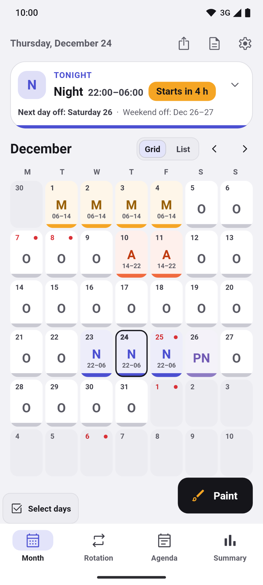</a>
  <a href="docs/readme/en/02-lista.png">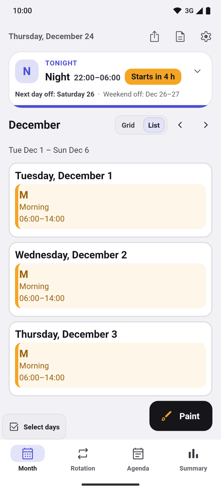</a>
  <a href="docs/readme/en/03-pintar.png">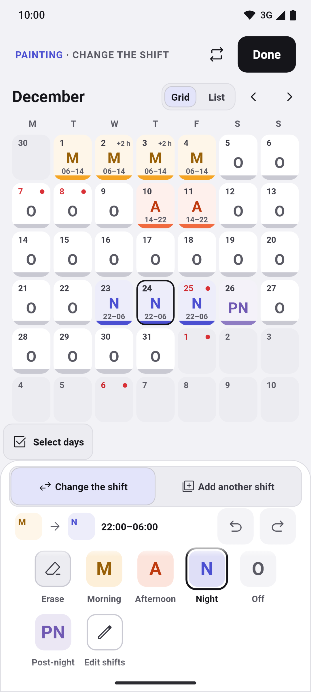</a>
  <a href="docs/readme/en/04-rotaciones.png">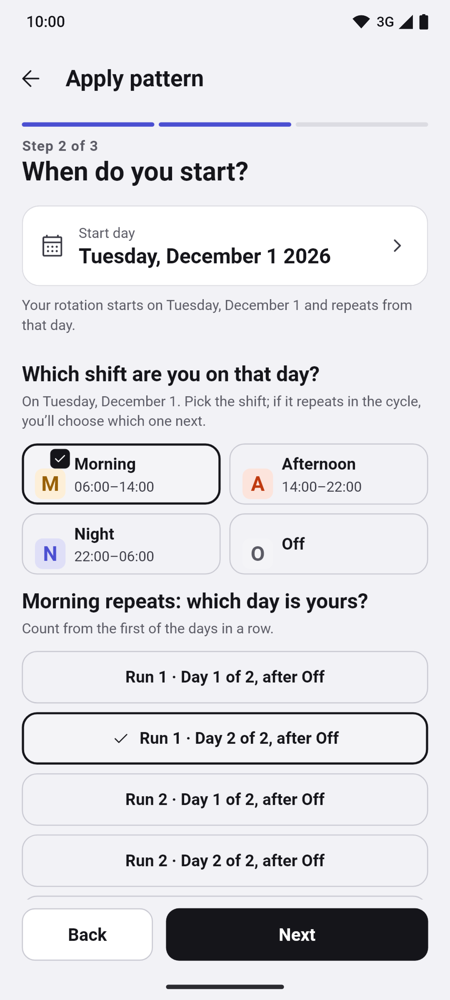</a>
  <a href="docs/readme/en/05-horas.png">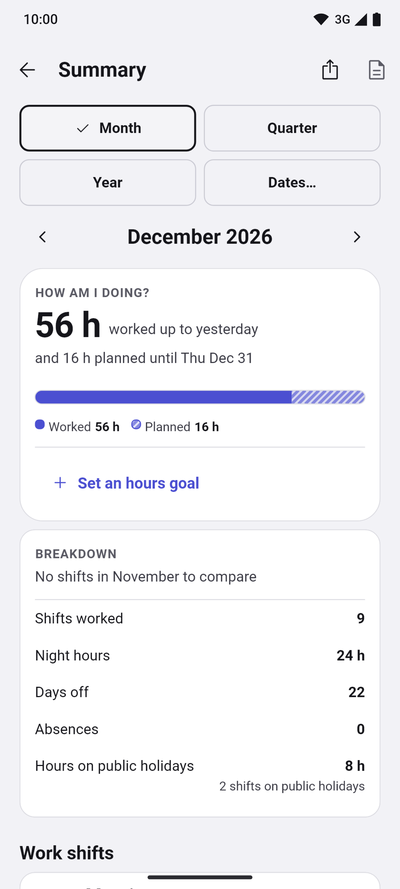</a>

More screenshots

  <a href="docs/readme/en/06-festivos.png">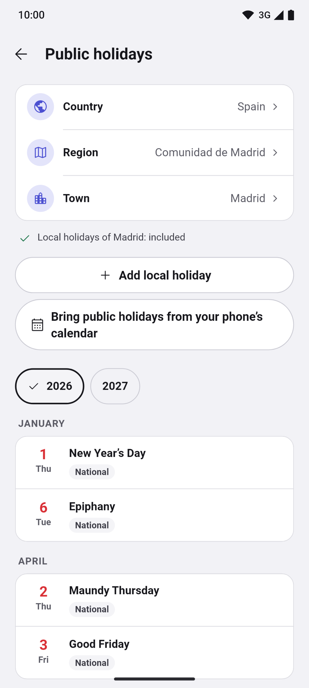</a>
  <a href="docs/readme/en/07-mes-oscuro.png">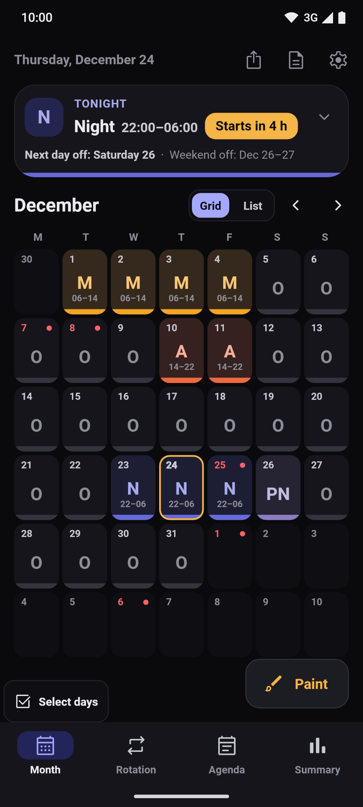</a>
  <a href="docs/readme/en/08-vacaciones.png">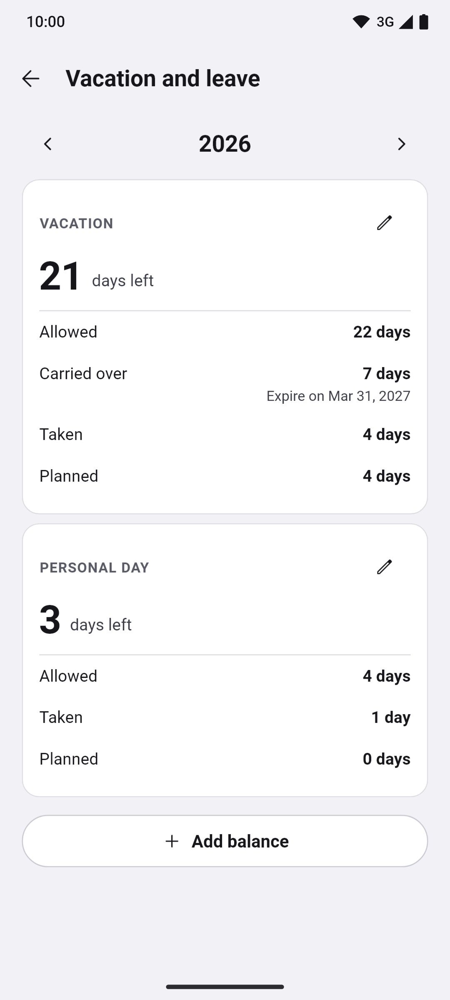</a>
  <a href="docs/readme/en/09-cambios.png">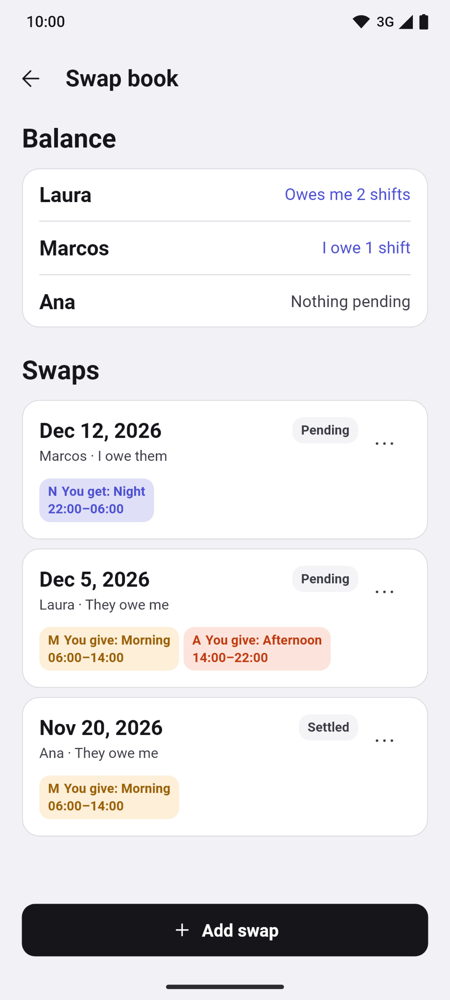</a>
  <a href="docs/readme/en/10-primer-uso.png">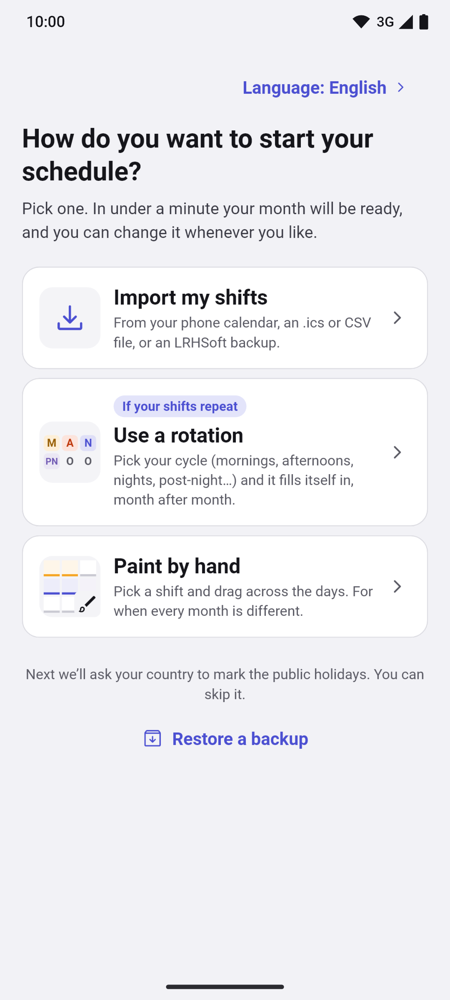</a>
  <a href="docs/readme/en/11-widgets.png">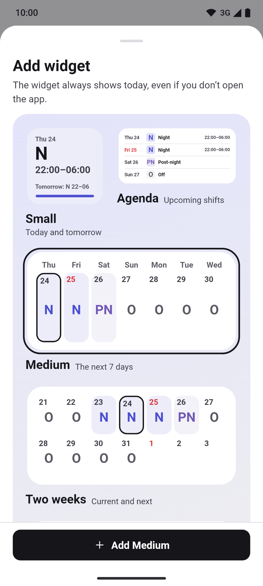</a>

Tap a screenshot to enlarge it. Real screens with made-up data, generated by
[Flutter tests](app/test/store/).

## Features

- **Month, rotation, agenda and summary.** A bottom bar (Month · Rotation ·
  Agenda · Summary) and a foldable Today card with your next shift, next day off
  and work streak. Every shift shows its colour, code and times, in a grid or a
  list, with an annual view and daily notes. A strip under the month shows its
  shifts, hours against your goal and next day off; tap it for that month's summary.
- **Paint shifts and rotations.** Tap or drag across days, double shifts, copy,
  paste, undo and redo. A rotation wizard with a preview covers rotating shifts,
  24/72, 4×4, 6×4, 5×2, 2-2-3, “2 and 2”, “3 and 1” and your own patterns.
  Choose the work shift for the two new rotations. Shift types, colours, icons
  and times are editable.
- **Public holidays by country.** Spain with its regions and municipalities, plus
  21 more countries (Portugal, Brazil, Latin America, Europe, the United States
  and Canada), all offline, and your own holidays.
- **Alarms, widgets and Do Not Disturb.** An alarm per shift type, note reminders
  and Android widgets, including a four-week one. They show overtime and early
  leave; the seven-day widget totals its hours. On Android, “Silence the phone
  on my shifts” mutes it while you work. Timing depends on system permissions and
  restrictions. iPhone has widgets too, on the home and lock screens.
- **Backup, reports and the phone calendar.** Automatic local backups and, on
  Android, a daily copy to a folder you choose (Drive, Dropbox, OneDrive or the
  phone), with a restore preview and “Test restore”. PDF and CSV reports of a
  month or any dates, “Keep up to date” to follow your shifts in the phone
  calendar, and import from LRHSoft, `.ics`, CSV and the phone calendar.
- **Hours, money and leave.** Worked, night and public holiday hours, early leave
  and overtime by blocks, with types and rates; choose whether each type counts
  toward your hours goal. Summary and PDF reports show your longest run of days
  worked in a row. Night and holiday allowances per hour; estimated gross and net pay
  with the withholding you set. Vacation and leave balances per year and type,
  with the days carried over and the days left.

More features

- **Rotation from the day.** Start, end or resume your rotation from the details
  for a selected day, with an explanation of what changes and the option to undo it.
- **Swap book.** Log a shift you gave to or received from a colleague, see their
  balance (“They owe me 2 shifts”, “I owe them 1 shift”), the state and shifts of
  every change, and apply it to the calendar with one undo.
- **Attachments and tasks.** Under a day's “More options”, “Attachments” keeps its
  photos, drawings and files, and “Tasks” is its checklist, each with one undo.
- **Compare calendars and phone appointments.** Up to six calendars side by side,
  and your phone's appointments next to your shifts; Turnly only reads them.
- **Appearance.** Accent colours, ready-made palettes, a calendar background
  picture, the first line of a note in the month cell, a click when you paint and
  a bigger shift code.
- **Multiple calendars.** As many as you want, each with its own rotations and days.
- **Accessibility.** Language picker, screen-reader support, larger text and shifts
  that never rely on colour alone.

## Privacy

Shifts and settings are stored on your phone. No server of ours, analytics,
tracking or crash-report uploads. It asks for **calendar** access to import or
export, and **notification and alarm** permissions for reminders.

Permissions and backups

It does not request location, contacts, camera or microphone access.

Google or Apple system backups can include your data, including absences.
Exporting to a synced calendar or sharing a backup sends data to the destination
you choose. The `.turnly` backup file is not encrypted.

[Website](https://turnly.mainshai.com/en/) · [Privacy policy](https://turnly.mainshai.com/en/privacy/) ·
[Technical details](docs/privacy.en.md) · Support: **turnly@mainshai.com**.

## What's new

- **1.1.0 (13 Nov 2026):** the iPhone gets everything from 0.10.0: overtime by blocks, rotation actions from the day, the month strip, your longest work run and the new rotations. iPhone widgets show overtime and a seven-day hours total.
- **0.10.0 (12 Nov 2026):** overtime by blocks with types and rates, and rotation actions from the day. A month strip with your next day off, longest work run in Summary, Android widgets with overtime and a seven-day hours total, and “2 and 2” / “3 and 1” rotations.
- **1.0.0 (10 Nov 2026):** first version on the App Store, for iPhone. Android stays in Google Play testing.

See [CHANGELOG.md](CHANGELOG.md) or the [releases](https://github.com/dferrandizmont/turnly/releases).

## Contributing

Bug reports, ideas and translations are welcome. How to build, test and
contribute: [CONTRIBUTING.md](CONTRIBUTING.md).

## License

Code: [MIT](LICENSE), Copyright (c) 2026 Daniel Mont Ferrandiz. Original content:
[CC BY-SA 4.0](LICENSE-CONTENT.en.md). Official holiday sources and third-party
materials keep their own terms, detailed in those licences.

To report a vulnerability: [SECURITY.en.md](SECURITY.en.md).
